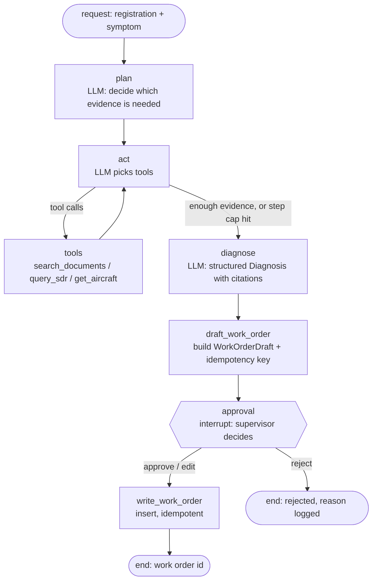

# Agent sketch

Status: **DRAFT (Phase 0)**. This is a sketch to challenge in Phase 1 `DESIGN.md`, not a final design. The spike implements a cut-down version in `spikes/`.

## Graph



- **State** (typed): `registration`, `symptom`, `messages`, `evidence: list[Evidence]`, `step_count`, `diagnosis: Diagnosis | None`, `draft: WorkOrderDraft | None`, `decision: ApprovalDecision | None`, `work_order_id: str | None`.
- **Step cap:** `act` loops at most N times (N set in config; the spike uses 6). When the cap is hit, the agent goes to `diagnose` with whatever evidence it has and must say that the evidence is incomplete.
- **Approval** uses LangGraph `interrupt()` with a checkpointer (verified API, 2026-10-28: `from langgraph.types import interrupt, Command`; resume with `Command(resume=...)` on the same `thread_id`). The interrupt payload is the draft. The resume value is an `ApprovalDecision`.
- **Writes happen only after the interrupt.** No tool the LLM can call writes to the database. `write_work_order` is a graph node, not an LLM tool, so the model cannot skip approval.
- **Idempotency (revised in DESIGN v2 §6.3 after the security review):** **one work order per run** (`work_orders.run_id UNIQUE`). The client's `Idempotency-Key` only dedupes `POST /runs` retries, scoped to `(created_by, client_key)`, and the same key with a different payload returns 409. The model never sees or produces a key. The v1 fallback, `sha256(registration + title + date)`, was removed, because two real faults on one aircraft on one day collided and the second work order was silently dropped. Spike check 3 still describes the intended behaviour: a retried request does not create a second work order.
- **Approval is a server-side record, not the resume value.** The decision endpoint takes the approver from the JWT. It writes an `approvals` row through a compare-and-set on `runs.status`, bound to `draft_sha256`. The `write` node re-reads that row in the same transaction as the work-order and audit inserts (DESIGN §6.3).

## Tools the LLM can call (all read-only)

```python
from datetime import date
from typing import Literal
from pydantic import BaseModel, Field

Registration = Field(pattern=r"^MX-\d{3}$")          # fictional fleet only
JascCode = Field(pattern=r"^\d{4}$")                  # e.g. 3230 = landing gear retraction

class SearchDocumentsArgs(BaseModel):
    """Hybrid search over handbooks, AC 43.13-1B and Airworthiness Directives."""
    query: str = Field(min_length=3, max_length=500)
    sources: list[Literal["handbook", "ac", "ad"]] | None = None
    aircraft_make: str | None = None      # metadata filter, mainly for ADs
    aircraft_model: str | None = None
    top_k: int = Field(default=5, ge=1, le=10)

class DocHit(BaseModel):
    chunk_id: str          # e.g. "faa-amt-airframe:p412:c2" or "ad:2026-09170:c4"
    source: Literal["handbook", "ac", "ad"]
    title: str
    page: int | None       # PDFs
    ad_number: str | None  # ADs, e.g. "2026-09-03"
    text: str
    score: float

class QuerySdrArgs(BaseModel):
    """Aggregate or list Service Difficulty Reports. Structured filters, not raw SQL."""
    aircraft_make: str | None = None
    aircraft_model: str | None = None
    jasc_code: str | None = JascCode
    part_number: str | None = None
    text: str | None = Field(default=None, description="Keyword (full-text) match on the discrepancy text")
    since: date | None = None
    until: date | None = None
    mode: Literal["list", "count_by_jasc", "count_by_part", "count_by_month"] = "list"
    limit: int = Field(default=20, ge=1, le=100)

class GetAircraftArgs(BaseModel):
    """Get one fleet aircraft: type, engines, hours and cycles, and its last 5 work orders."""
    registration: str = Registration
```

**Read-only SQL decision (open for Phase 1):** `PLAN.md` says "read-only SQL". The sketch exposes **structured filters plus aggregation modes** that compile to parameterised SQL rather than letting the LLM write free-form SQL. That removes a whole class of injection and exfiltration risk and is easier to test. With 183k+ real SDR rows, aggregation questions ("most common JASC codes on CRJ-900 this year") are the main SQL-type workload, and the `mode` field covers them. A free-form `run_sql` tool (read-only role, allowlisted views, statement timeout, row limit) is added only if Phase 3 evals show gaps. Either way, the database role stays read-only at the database level (Phase 5).

## Structured outputs (not tools)

```python
class Citation(BaseModel):
    chunk_id: str | None = None      # manual passage
    fault_id: str | None = None      # fault-log row
    quote: str = Field(max_length=300)

class Diagnosis(BaseModel):
    likely_causes: list[str] = Field(min_length=1, max_length=5)
    confidence: Literal["low", "medium", "high"]
    reasoning: str
    citations: list[Citation] = Field(min_length=1)
    evidence_incomplete: bool = False
    safety_notes: list[str] = []     # e.g. "AD 2026-09-03 applies: comply before further flight"

class WorkOrderDraft(BaseModel):
    registration: str
    title: str = Field(max_length=120)
    priority: Literal["low", "medium", "high", "urgent"]
    diagnosis_summary: str
    steps: list[str] = Field(min_length=1, max_length=20)
    citations: list[Citation]
    # No idempotency_key: the server derives one work order per run (DESIGN v2 §6.3).

class ApprovalDecision(BaseModel):
    # Request body of POST /runs/{id}/decision. The approver comes from the JWT, never from the body.
    action: Literal["approve", "edit", "reject"]
    draft_sha256: str                            # the draft the supervisor saw; a mismatch returns 409
    edited_draft: WorkOrderDraft | None = None   # required when action == "edit"; registration can't change
    reason: str | None = None                    # required when action == "reject"
```

Structured output is requested with a JSON schema (`response_format`). The response is validated with Pydantic, with bounded retries (2) that feed the validation error back to the model. After that it fails cleanly.
