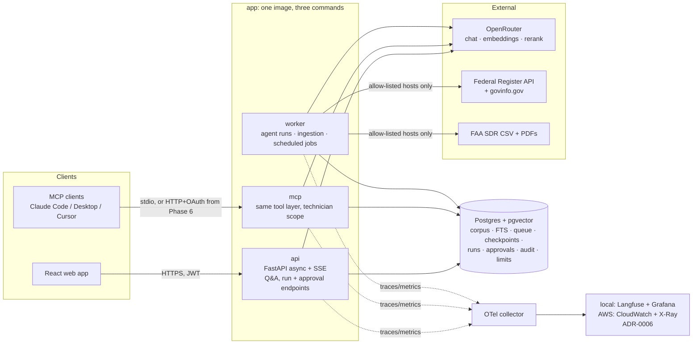
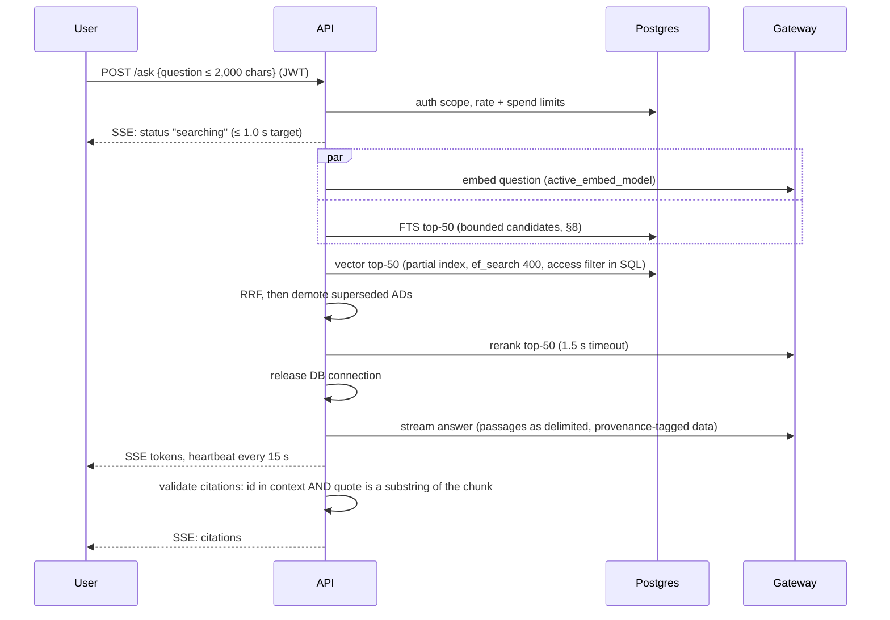
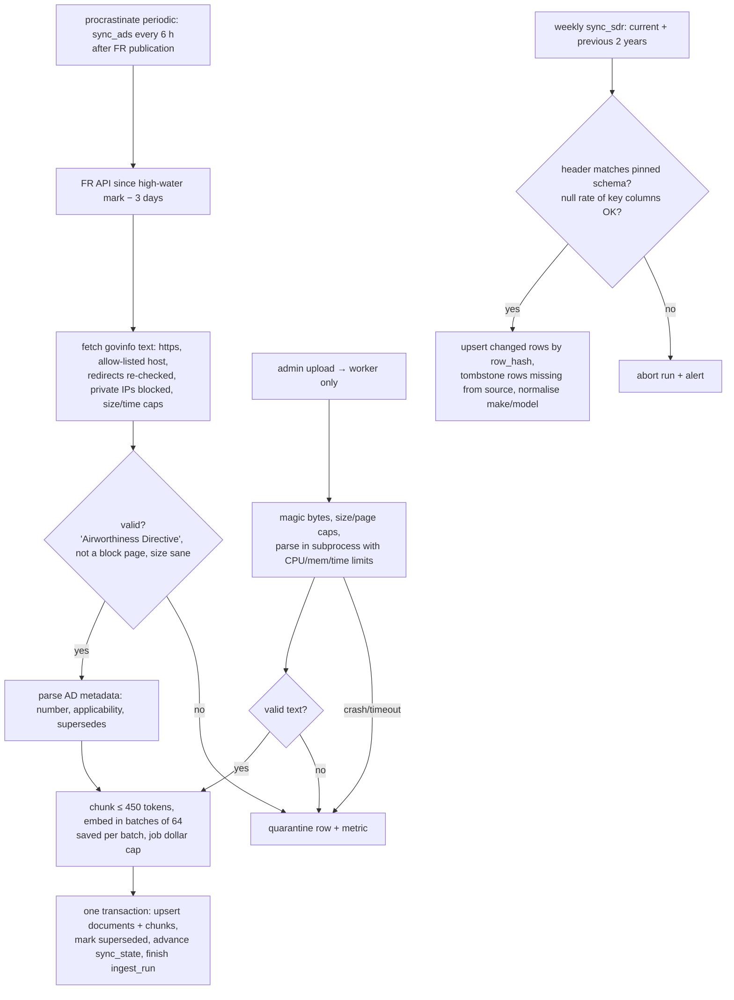

# Design

Status: **v2, APPROVED 2026-10-29** at the Phase 1 gate. This is the Elephant draft revised after three Goldfish reviews (security, cost and scale, operations), and every finding is in the [Review log](#review-log). Later changes are logged with their reason. Last updated 2026-10-29.

Inputs: `PLAN.md`, `docs/SCOPE.md`, `docs/DATA.md`, `docs/AGENT.md`, `docs/SPIKE.md`. Decisions that had real alternatives are recorded in `docs/adr/`. Prices marked ASSUMED were not read from a live price page and must be re-checked before money is spent (ADR-0005).

## 1. Goals and constraints

- There are three core paths: **cited Q&A**, **live ingestion**, and **troubleshoot → draft work order → human approval** (see `SCOPE.md`).
- Every model call (chat, embeddings, rerank) goes through one OpenAI-compatible gateway, OpenRouter by default. The base URL, key and model IDs come from config only.
- The same codebase runs locally with one command (Docker Compose), on AWS (Terraform) and later on Kubernetes (Helm). The deployment target is chosen by config.
- Portfolio scale, built with production discipline. Normal use is a few concurrent users; the design target is 50 concurrent users in the Phase 8 load tests. The full corpus history is about 10k+ ADs (about 200k chunks) and about 1.5M+ SDR rows.
- Tooling is free or self-hosted. The only paid usage is model calls, each with a cap. AWS runs only for measured windows and is then destroyed.
- **Complexity budget: one maintainer.** Each component must earn its place, and a component is optional until a measurement needs it (§4).

## 2. Service-level targets

Later phases are judged against these. Values marked *provisional* are re-baselined from Phase 3 measurements, and any change is logged here with its reason.

| Area | Target | Measured by | Basis |
| --- | --- | --- | --- |
| Q&A first event | p95 **≤ 1.0 s** from request to first SSE event (retrieval status) | OTel spans | No model call on this path |
| Q&A time to first token (TTFT) | p95 **≤ 3.0 s** to the first SSE byte of *answer content* | OTel spans; Phase 8 load test | Critical path is embed → vector → RRF → rerank → model TTFT, about 3.0–3.6 s if the laptop p95s are simply added (§8). This is **at risk**, so model TTFT is measured in Phase 2 and the levers are in §8 |
| Q&A full answer | p95 **≤ 12 s** | OTel | TTFT plus 400–800 tokens at about 100 tok/s (ASSUMED) |
| Agent run | p95 **≤ 45 s** from symptom to draft ready for approval | Trace per run | 8 act steps × about 2.5 s, plus about 4 searches × about 2.4 s, plus diagnose. Estimated at about 35 s |
| Availability | **≥ 99.5 % synthetic-probe success while deployed**. Degraded (retrieval-only) answers count as available | Synthetic probe + ALB | Single-AZ RDS alone uses most of this budget (its SLA is about 99.5 %, ASSUMED), so Multi-AZ is switched on for any window we report |
| Freshness | A new AD is **searchable ≤ 24 h** after Federal Register publication; the alert fires at **20 h** | `freshness_lag` SLI (§6.2) | AD sync runs every 6 h, after FR publication |
| Cost per Q&A | **≤ $0.005** mean, **≤ $0.02** p95 | `llm_calls` ledger | Estimated about $0.003: rerank $0.0025 (83 %) + answer about $0.0005 + embedding $0.00004 |
| Cost per agent run | **≤ $0.05** mean on the default tier; hard cap **$0.25**, checked *before* each call | Ledger per run | Growing context: about 85k input tokens typical and about 285k worst case. That is about $0.02 typical and about $0.05 worst on Haiku 5.5, including $0.0025 per search |
| Spend limits | Per user/token: **60 Q&A per hour, 20 agent runs per day, 2 concurrent runs, $1 per day**. Global: **$5 per day breaker** (degrades to retrieval-only). OpenRouter credit limit **$20** per key, with an alert at 50 % | Postgres counters + ledger | Starting values, tuned in Phase 4. Without them, one leaked token costs about $60 per hour (security review, cost review) |
| Retrieval quality | recall@5 **≥ 0.90** and MRR@5 **≥ 0.75** on the golden set (*provisional*) | Eval harness, CI | Spike: 0.97 / 0.87 on 40 questions (`SPIKE.md` §2b) |
| Answer quality | groundedness ≥ 0.90; citation correctness ≥ 0.90; correct refusal ≥ 0.90 (*provisional*) | Calibrated judge (Phase 3) | Set in Phase 3 |
| Agent quality | correct tool ≥ 0.95; valid arguments ≥ 0.98; **writes without a persisted, authorised approval = 0** (hard invariant) | Evals + property test (§7.6) | Spike: 16/16 on tool calls, 7/7 on interrupt checks |

## 3. Architecture



### 3.1 Changes from the starting architecture in `PLAN.md`

| Plan said | Design says | Why |
| --- | --- | --- |
| Separate "LangGraph agent service" | The agent is a library. **Runs execute as jobs in the worker**, and the API enqueues them and streams progress from a `run_events` table | Runs survive deploys, client disconnects and SIGTERM. Any API replica can attach to any run, and the worker scales on queue depth ([ADR-0004](adr/0004-agent-execution.md), revised after the cost and ops reviews) |
| Redis queue locally, SQS on AWS | **Postgres job queue** (`procrastinate`) everywhere | One backend in every environment; enqueue is transactional ([ADR-0001](adr/0001-job-queue.md)) |
| Redis for cache and rate limits | **No Redis.** Rate limits, spend counters and the exact cache are Postgres tables. The semantic cache (Phase 4) uses pgvector | At about 10 limit checks per second, an `INSERT … ON CONFLICT DO UPDATE … RETURNING` counter is enough. It saves $0.4–3 per day, a Terraform module and a failure domain. **Revisit if** limit queries exceed 10 % of DB time ([ADR-0009](adr/0009-no-redis.md)) |
| (not specified) | Hybrid retrieval in Postgres: FTS + pgvector `halfvec` HNSW, RRF, then rerank | One datastore ([ADR-0002](adr/0002-retrieval-stack.md)) |
| SQS on AWS | Not used | Covered by ADR-0001 |

## 4. Components

| Component | Responsibility | Key technology (versions checked 2026-10-29) | If it's down |
| --- | --- | --- | --- |
| `app/api` | REST + SSE, auth, limits, Q&A orchestration, run creation, the approval endpoint (the **only** caller that resumes a graph) | FastAPI 0.162, uvicorn, pydantic 2.14, pydantic-settings 2.16 | No service |
| `app/agent` | LangGraph graph (`AGENT.md`): plan → act ⇄ tools → diagnose → draft → **interrupt** → write | langgraph 1.2.18, langgraph-checkpoint-postgres 3.2.0 | Runs queue up |
| `app/tools` | **The single tool layer** (`search_documents`, `query_sdr`, `get_aircraft`, `create_draft` for MCP). It receives only a `tools_ro` pool through dependency injection, and an import test forbids `app_rw` | — | — |
| `app/retrieval` | FTS + vector + RRF, access filters before rerank, supersession, rerank, context budget, active-embedding-model check | pgvector 0.5.1 (Python) | Q&A degraded |
| `app/llm` | Gateway: `supported_parameters` (cached, 1 h TTL), `strict_schema()`, retries with validation feedback, timeouts, fallback model, **pre-call spend check**, **outbound redaction** for every request kind, cost ledger | openai SDK 3.40 | Retrieval-only mode |
| `app/ingest` | Fetchers (host allow-list), content validation, quarantine, parsing (uploads parsed in a sandboxed subprocess), chunking, embedding, upserts, run ledger | pypdfium2 ([ADR-0003](adr/0003-pdf-parser.md)), procrastinate 3.10 | Freshness alert |
| `app/mcp` | MCP server over `app/tools`. Read tools plus `create_draft`; **never decision or resume** (§6.4) | mcp 2.3.0 (spec and auth re-checked in Phase 6) | MCP only |
| `app/migrate` | One-shot `migrate` command: Alembic, which also wraps the procrastinate and LangGraph migrations (§5.2) | Alembic | Deploy blocked |
| `web/` | Chat with streaming and citations, run view, supervisor approval queue. Sanitised markdown, strict CSP (§7.2) | React + Vite (pinned in Phase 2) | — |
| `infra/` | Compose, Terraform (Phase 8), Helm (Phase 8b) | — | — |

**Repository layout:** one `uv` workspace. The `app` package starts as `api`, `worker`, `mcp` or `migrate`. `web/` is separate. One container image, pinned by digest.

**Versions pinned identically everywhere:** one Postgres major and one pgvector version, picked from the RDS-supported matrix in Phase 2. We need pgvector ≥ 0.8 for iterative index scans, which is ASSUMED to be available on RDS and is checked in Phase 2. Compose, testcontainers and Terraform use the same versions, and startup asserts the `vector` extension version.

## 5. Data model (Postgres)

### 5.1 Tables

| Table | Key columns | Notes |
| --- | --- | --- |
| `documents` | `doc_id` PK, `source` (handbook / ac / ad / upload), `ingest_origin` (official / admin_upload), `title`, `ad_number`, dates, `supersedes[]`, `superseded_by`, `make[]`, `models[]`, `url` (https, allow-listed host), `sha256`, `access_level` enum (`public`, `restricted`), `ingested_at` | Official FAA material is `public`. Uploads default to `restricted` |
| `chunks` | `chunk_id` PK, `doc_id`, `page`, `ord`, `text` (≤ 450 tokens), `tsv` (generated) | GIN on `tsv` |
| `chunk_embeddings` | (`chunk_id`, `embed_model`) PK, `embedding halfvec(1024)` | **One partial HNSW index per `embed_model`**, built `CONCURRENTLY` after the backfill. Separate table so two models can coexist per chunk (§8.1; change P2-1) |
| `retrieval_config` | single row: `active_embed_model`, `corpus_version` | The API reads it. Query and index model must match, and retrieval asserts this (§8.1) |
| `sdr` | `sdr_id` PK, `difficulty_date`, `jasc`, raw and normalised make/model, part fields, `discrepancy`, `tsv`, `row_hash`, `tombstoned_at` | **FTS only, no embeddings** (an HNSW index over 1.5M rows would need an instance of about 32 GB). B-tree on `(model, jasc, difficulty_date)` |
| `model_aliases` | `raw` → `canonical` | Spike §4 |
| `fleet` | `registration`, `type`, `engines`, `hours`, `cycles`, `in_service` | Synthetic |
| `runs` | `run_id` UUIDv4, `created_by` (from the JWT), `registration`, `client_key`, `status` (queued / running / pending_approval / decided / written / rejected / failed / expired), `graph_version`, `prompt_version`, `config_version`, `state_schema_version`, `draft_sha256`, `cost`, `heartbeat_at`, timestamps | Unique `(created_by, client_key)`. The status lives here, not only in the checkpoint |
| `run_events` | `run_id`, `seq`, `ts`, `kind`, `payload` | SSE tails this table, so a client can re-attach with `GET /runs/{id}/events?after=seq` |
| `approvals` | `approval_id`, `run_id` UNIQUE, `approver_id` (from the JWT), `action`, `draft_sha256`, `edited_draft`, `ts` | One decision per run, enforced by compare-and-set (§6.3) |
| `work_orders` | `wo_id`, `run_id` UNIQUE, `approval_id`, `registration`, `title`, `priority`, `status`, `diagnosis`, `steps`, `citations`, `created_by`, `approved_by`, timestamps | **One work order per run.** Written only by the `write` node |
| `audit_log` | `id`, `ts`, `actor` (from the JWT), `action`, `run_id`, `payload_redacted`, `prev_hash`, `row_hash` | Hash chain checked by a daily job. Monthly partitions from Phase 8 (change P2-2) |
| `llm_calls` | `ts`, `run_id`, `user_hash`, `kind`, `model`, `provider`, tokens, `cost`, `latency_ms`, `status`, `prompt_version`, `config_version` | Cost ledger. Monthly partitions from Phase 8 (change P2-2) |
| `limits` | `(subject, window, kind)` → counter | Rate and spend limits (replaces Redis) |
| `ingest_runs` | `source`, start and finish times, status, fetched / inserted / updated / quarantined counts, `cost` | One row per sync run |
| `sync_state` | `source`, `high_water_mark` | Advanced only after commit. Each sync re-reads a 3-day overlap |
| `quarantine` | `url`, `reason`, `body_sha256`, first and last seen, `attempts` | Admin `replay` command |
| LangGraph checkpoints, procrastinate tables | Created by the libraries, but through `migrate` | — |

### 5.2 Schema ownership and migrations

- **Alembic owns all DDL**, including revisions that apply the procrastinate migrations and LangGraph checkpointer setup, pinned to the versions in `uv.lock`. App entrypoints never call `setup()`.
- **Roles:**

  | Role | Rights |
  | --- | --- |
  | `migrator` | All DDL. Never held by a running service |
  | `app_rw` | The API's own tables, `audit_log` INSERT and SELECT, checkpoints |
  | `tools_ro` | SELECT on allow-listed views. `statement_timeout` 5 s and `hnsw.ef_search` set on the role |
  | `ingest_rw` | Corpus tables, `audit_log` INSERT |
  | `mcp_rw` | `tools_ro` rights plus INSERT on drafts and `audit_log` |

  Extensions are created once at bootstrap (Terraform or the Compose init script). No role except `migrator` can touch the checkpoint tables' DDL, and only `app_rw` and the worker's run role can write checkpoints.
- **Order:** `migrate` runs as a one-shot task before any service update. In Compose that is `depends_on: service_completed_successfully`; in CD it is an ECS RunTask gate.
- **Expand/contract only.** Release N's changes are additive, and destructive changes wait for N+1, so N-1 code runs on the N schema. **Rollback means redeploying the previous image, never a down-migration.**
- Index builds use `CREATE INDEX CONCURRENTLY`, with `maintenance_work_mem` set in the migration.

### 5.3 Retention and backups

| Data | Rule |
| --- | --- |
| Checkpoints | When a run reaches a terminal state, keep only its final checkpoint. Purge those after 30 days. `runs`, `approvals`, `work_orders` and `audit_log` are the durable record. Estimate: about 3–8 MB per run without this rule |
| Finished queue jobs | Pruned after 30 days |
| `run_events` | Pruned after 30 days |
| `llm_calls`, `audit_log` | Monthly partitions from Phase 8 (change P2-2). `audit_log` is kept for the lifetime of the deployment |
| Backups | RDS automated backups for 7 days with PITR. A final snapshot on destroy (Terraform variable, default true). `make backup` / `make restore` run pg_dump of the app schemas, plus an embeddings export so a rebuild doesn't pay to embed again. **A restore drill is a Phase 8 exit check** |

## 6. Data flows

### 6.1 Cited Q&A



Failure handling:
- **Reranker fails or times out (1.5 s):** use the **RRF order immediately**, which scored **0.80** recall@5 on Postgres (0.85 in the spike; see `docs/retrieval.md` §3.6) and adds no extra round trip, and flag the response "degraded". The rewrite fallback is used **only on the agent path**, where TTFT doesn't apply (§8).
- **Embedding API down:** FTS only, with the "degraded" flag.
- **Model fails:** retry once on the fallback model. If that also fails, return the retrieved passages with citations and "generation unavailable".
- **A citation fails validation:** strip it and mark the sentence unsupported. If more than 30 % of sentences are unsupported, refuse.
- **No chunk above the relevance threshold:** refuse with "not found in the sources", and point to the OEM manual where that applies.
- **Spend breaker tripped:** retrieval-only answer, with the reason shown.
- **Client disconnects:** cancel generation, so no further spend.

### 6.2 Live ingestion



Failure handling:
- **Idempotent:** ADs are keyed on `document_number`, SDR rows on `sdr_id` + `row_hash`, files on `sha256`. Uploads are stored under their hash, never their filename.
- **Retries:** exponential backoff, at most 5. A parser crash, a block page or a validation failure is **quarantined, not retried**.
- **Partial embedding:** saved per batch, so a retry pays only for missing batches. Each job has a dollar cap and there is a daily ingestion cap.
- **Visibility:** a document becomes searchable only when its transaction commits.
- **Polite fetching:** an honest User-Agent and at least 0.1 s between requests. We never get around bot checks.
- **Observability that works without the optional observability stack (Phase 2):**
  - `freshness_lag` = max(now − publication_date) over FR results that aren't indexed yet. Alert at 20 h.
  - Alert on any failed run, quarantine above 5 % of a run, or a run that fetches 0 rows.
  - Alerts go out by email or webhook straight from the worker.

### 6.3 Troubleshoot → draft → approval

```mermaid
sequenceDiagram
    participant T as Technician
    participant A as API
    participant W as Worker
    participant DB as Postgres
    participant S as Supervisor
    T->>A: POST /runs {registration, symptom} + Idempotency-Key
    A->>DB: limits check; INSERT runs (created_by from JWT) ON CONFLICT (created_by, client_key) → return existing run
    A->>DB: enqueue run job
    A-->>T: run_id; SSE tails run_events
    W->>DB: graph: plan → act ⇄ tools (tools_ro) → diagnose → draft (heartbeat_at each step)
    W->>W: code checks on draft: registration == run.registration, priority floor from cited ADs
    W->>DB: checkpoint at interrupt; runs.status = pending_approval, draft_sha256
    S->>A: GET /approvals (supervisor)
    S->>A: POST /runs/{id}/decision {action, draft_sha256, edited_draft?}
    A->>DB: UPDATE runs SET status='decided' WHERE id=… AND status='pending_approval' AND not expired AND created_by ≠ approver RETURNING
    A->>DB: INSERT approvals (approver from JWT)
    A->>DB: enqueue resume job
    W->>DB: write node, ONE transaction: re-read approvals row, check its hash matches the checkpoint draft, INSERT work_order, INSERT audit_log
    A-->>S: work order id (via run_events)
```

The rules behind the approval invariant (security review, finding 1):
- **The approver comes from the verified JWT only.** Any approver in the request body is ignored. The role must be supervisor, and the approver can't be the creator.
- **One decision per run:** a compare-and-set on `runs.status`, plus `approvals.run_id UNIQUE`. Two concurrent decisions mean one wins and the other gets 409.
- **The decision is bound to the draft the supervisor saw:** `draft_sha256` must match, or the API returns 409. An edit may not change `registration`, and the edited draft is re-validated against `fleet` and the citation rules.
- **The write node doesn't trust the resume value.** It re-reads the `approvals` row in the same transaction as the work-order and audit inserts.
- **Only the decision endpoint resumes graphs.** `thread_id` is resolved on the server from `run_id`. No tool, MCP route or admin path can call `Command(resume=…)`.

Idempotency (security review, finding 2): **one work order per run** (`work_orders.run_id UNIQUE`). The client's Idempotency-Key only dedupes `POST /runs` retries, scoped to `(created_by, client_key)`. The model never sees or produces a key. If the same key arrives with a different payload, the API returns 409. The old date-based fallback is removed, because it collided for two real faults on one aircraft in one day.

Failure handling:
- **Step cap reached (8 act → tools cycles) or the per-run cost cap would be crossed (checked before the call):** go to `diagnose` with `evidence_incomplete=true`.
- **Tool argument validation fails:** return the error to the model. After 2 retries, stop that branch.
- **Unknown registration:** the tool returns "not in fleet", and the draft check rejects any other registration (the DeepSeek failure from the spike).
- **Worker dies or is stopped (deploy, scale-in):**
  - The worker handles SIGTERM by finishing its current step and then stopping, with ECS `stopTimeout` = 120 s.
  - The `reap_runs` job (every 5 min) re-enqueues runs with no heartbeat for 5 minutes. They resume from their last checkpoint, at most 2 times, then fail with an audit entry.
- **Client disconnects:** the run continues to the interrupt under its caps, and the client can re-attach through `run_events`.
- **Approval never given:** `expire_approvals` marks runs older than 7 days `expired` and writes an audit entry. The compare-and-set also refuses expired runs, even if the job hasn't run yet.

### 6.3.1 Run versioning across deploys (ops review, finding 2)

- Every run records `graph_version`, `prompt_version`, `config_version` and `state_schema_version`.
- State models only change in backward-compatible ways: new fields are optional and nothing is renamed.
- A breaking graph change keeps the previous compiled graph registered for resume until no run in `pending_approval` uses it.
- CD has a pre-deploy check: no pending runs may be on a graph version the new release doesn't serve. If there are any, the deploy either migrates them or expires them, with an audit entry.
- A test resumes a checkpoint fixture written by the previous release tag.

### 6.4 MCP (security review, finding 4)

- **Tools exposed:** the read tools and `create_draft`. `create_draft` starts a normal run, which lands in the same approval queue. MCP never exposes decisions, resume, admin or ingestion.
- **Identity:**
  - Until Phase 6 auth passes its tests, MCP runs over stdio or localhost only, as one configured user.
  - From Phase 6, each HTTP session maps to one real user through OAuth, following the current MCP auth spec. Tokens are audience-bound and never passed through. The role is at most technician.
- **Limits and access:** the same per-user limits and audit log as the API. The process holds `mcp_rw` only. It is not routed on the public ALB before Phase 6.

## 7. Cross-cutting

### 7.1 LLM gateway
- **Spike rules (`SPIKE.md` §1):** filter by `supported_parameters` (cached with a 1 h TTL) and use `require_parameters: true`. Always set `max_tokens`, sized for reasoning. Use strict schemas and `data_collection: "deny"`. Pin providers (`order` + `allow_fallbacks: false`) for evals, and use an allow-listed `order` in prod. Log `usage.cost` and the serving provider on every call.
- **Pre-call spend check:** estimate prompt tokens × price and refuse the call if it would cross the per-run cap or the user's daily cap.
- **Outbound redaction:** one function applied to chat, embed and rerank requests. No user identifier is sent upstream. The salted hash lives only in our ledger (change P2-5). OpenRouter's OpenAPI spec (checked 2026-10-29) shows that `/embeddings` and `/rerank` accept the same `provider` object as chat, including `data_collection` and `zdr`. The gateway sends it on all three. Whether the provider actually enforces it can't be observed from outside, so that part stays **UNVERIFIED**.
- **Context bounds:** each tool result is capped at about 2k tokens. `query_sdr` list mode returns 20 rows by default and truncates discrepancy text. After each step, `messages` keeps only evidence IDs and summaries.
- **Model routing (start):** classification, and the agent's rewrite fallback, run on the cheapest model. Phase 3 picks the answer and agent model (Haiku 5.5 or GPT-6 Luna), and the other becomes the fallback. A strong tier (Phase 4) is allowed **only if** the worst-case run trace stays under the $0.25 cap.
- **`provider_canary` (daily):** for every configured model ID, check `GET /models` (present, parameters unchanged, price within ±20 %, no expiration). Then make one tiny live call each for chat, embed and rerank. Alert on any difference.
- **Keys:** one OpenRouter key per service (api, worker, mcp, eval), each with a provider-side credit limit. Rotating the key pasted in chat during Phase 0 is a **Phase 1 gate item**.

### 7.2 Trust boundaries and output safety (security review, finding 3)
- Retrieved documents, SDR text and tool output are **untrusted data**. They reach the model only inside delimited data blocks tagged with `source`, `ingest_origin` and `doc_id`, never as instructions. The system prompt says so, and the Phase 5 red-team suite tests it.
- Citation validation checks that `chunk_id` is in the context **and** that `quote` is a normalised substring of that chunk.
- Before the interrupt, code checks every draft:
  - The registration equals the run's registration.
  - The priority is never below the floor implied by any cited AD with "before further flight" wording.
  - Every citation validates.
- **Web rendering:**
  - Model output is rendered as sanitised markdown, with no raw HTML and no remote images.
  - Links are allowed only to faa.gov, federalregister.gov, govinfo.gov and the app itself.
  - A strict CSP and the security headers are on from Phase 2.
- `access_level` is applied **inside the FTS and vector SQL**, before rerank, so restricted text never reaches Cohere or a user without access. Every cache key includes the caller's access scope and `corpus_version`.

### 7.3 Identity and access
- **Login:** JWT auth from Phase 2. The local dev issuer is allowed only when `ENV=local`, and startup fails if it's enabled anywhere else. Signing keys live in Secrets Manager on AWS. OIDC comes in Phase 5.
- **Run access:**

  | Who | Can |
  | --- | --- |
  | The run's creator, supervisors, admins | Read a run and its events |
  | Supervisors other than the creator | Decide on a run |
  | Supervisors, admins | Read the audit log |

  `run_id` values are random UUIDv4.
- **Negative authorisation tests** for each endpoint, from Phase 2.

### 7.4 Config, prompts and supply chain
- **Config:** pydantic-settings and `.env.example`. The image carries no secrets.
  - The effective runtime config (models, k, thresholds, rerank top-N) is hashed into `config_version` at startup.
  - Prompts are files in `app/prompts/`, and their content hash is `prompt_version`.
  - Both versions are stamped on `llm_calls`, OTel spans, `runs` and eval reports.
  - Prompt changes go through the Phase 3 CI eval gate like code.
- **Supply chain from Phase 2:**
  - `uv.lock` with hashes, installed with `--frozen`. The base image is pinned by digest.
  - Dependabot and gitleaks run in CI. pip-audit runs without blocking, and becomes blocking in Phase 5.
  - PDFium CVEs are tracked explicitly, because it parses untrusted input.
  - The LangGraph checkpoint serializer runs without pickle or arbitrary-type fallback.

### 7.5 Runtime and capacity
- **Connection budget:** pools per process × processes ≤ 60 % of `max_connections`. Q&A releases its DB connection before streaming. The worker uses session-mode connections for LISTEN. RDS Proxy or PgBouncer is the Phase 8 lever.
- **SSE:**
  - A heartbeat every 15 s; the ALB idle timeout is 120 s.
  - The API scales on an "active streams per task" metric (target 25), not CPU.
  - The worker scales on queue depth.
  - Deregistration delay is 60 s.
- **FTS at scale:** candidates are bounded. The AND query runs first, and the OR query runs only if it returns fewer than 50 hits. Phase 2 benchmarks FTS p95 at **full-history size** (200k chunks), not spike size.

### 7.6 Testing
- **Core:** unit tests; integration tests on real Postgres through testcontainers; contract tests per tool; negative authorisation tests.
- **Property test:** no path reaches `write` without a persisted, JWT-attributed `approvals` row that matches the draft hash.
- **Recorded fixtures for each spike failure:**
  - a block page
  - 402
  - 404 on an unsupported parameter
  - 429 with Retry-After
  - truncated JSON (`finish_reason: length`)
  - a crash mid-batch that must resume without paying for any batch twice
- **Migration test:** upgrade from the previous release's schema dump with a pending checkpoint, then approve it.
- **A real two-process kill-and-resume test.** Today this is UNVERIFIED (`SPIKE.md` §3).
- **Nightly live contract job:** checks the FR API, govinfo and the SDR CSV header. It alerts; it doesn't fail CI.
- **Restore drill** (§5.3).

### 7.7 Scheduled jobs

| Job | Schedule | Alerts on |
| --- | --- | --- |
| `sync_ads` | every 6 h | failure, 0 rows, quarantine > 5 % |
| `sync_sdr` | weekly | header mismatch, null-rate guard, failure |
| `freshness_check` | hourly | `freshness_lag` > 20 h |
| `reap_runs` | every 5 min | runs failed after re-enqueue |
| `expire_approvals` | daily | — (audit entries) |
| `provider_canary` | daily | any difference |
| `audit_chain_verify` | daily | hash-chain break |
| retention prunes | daily | failure |

**Runbooks** go in `docs/runbooks/`, starting in Phase 2, for these cases:
- credit exhausted or 402
- source blocked or a quarantine spike
- embedder deprecated, so a re-embed is needed
- failed deploy or rollback
- restore from backup
- key rotation

### 7.8 Observability
OTel from the first endpoint, using the GenAI semantic conventions (re-checked in Phase 7). Traces carry `prompt_version` and `config_version`. Prompts and outputs in traces are redacted with the same function as outbound calls. Where traces go: **locally**, Langfuse and Grafana (an optional Compose profile); **on AWS**, CloudWatch and X-Ray, with no self-hosted ClickHouse on Fargate ([ADR-0006](adr/0006-observability.md)).

## 8. Retrieval configuration

From the experiment matrix in `SPIKE.md` §2b (40 questions, 49,871 chunks). The reasoning is in [ADR-0002](adr/0002-retrieval-stack.md).

| Setting | Value | Evidence |
| --- | --- | --- |
| Chunking | 220 words with 40 overlap (about 361 tokens; hard cap 450), AD chunks prefixed with the title | Spike §2. The 450-token cap keeps each document within one rerank unit (ASSUMED ≤ 500 tokens, re-checked) |
| Keyword side | Postgres FTS: OR query ranked by `ts_rank`, top 50 | **Measured parity with BM25**: 0.70 vs 0.68 recall@5. `ts_rank_cd` scored 0.38 and AND-then-OR added nothing (change P2-17) |
| Embedder | `voyageai/voyage-4-lite`, stored as `halfvec(1024)`, cosine | Ties `voyage-4-large` once reranked, at 1/6 of the corpus cost. halfvec makes the index about 0.6 GB at 200k chunks instead of about 1.6 GB (ASSUMED from pgvector's page layout) |
| Vector search | partial HNSW per model, **`ef_search` = 400** (set per query), iterative scan | At 100, HNSW returned 95.1 % of the exact top 50 (worst query 60 %). 400 gives 99.6 % for about +2 ms (change P2-18) |
| Fusion | RRF k=60 | Spike default, not tuned |
| Reranker | `cohere/rerank-4-pro` on the fused top 50, using the original question, **1.5 s timeout → RRF order** | Postgres: hybrid 0.80 → **0.97** recall@5, MRR 0.67 → **0.86** (spike: 0.85 → 0.97, 0.64 → 0.87) |
| Query rewrite | **Off for Q&A.** Used on the agent path when rerank fails | Neutral with rerank, +0.10 recall without it |
| Context k | 5, or 8 when the question names an AD or a model | k=8 is UNVERIFIED |

**Per-query budget** (laptop measurements):

| Step | Cost | p50 / p95 |
| --- | --- | --- |
| Query embedding | ~$0.00004 | 0.35 / 0.66 s (n = 40, 2026-10-30; was 0.93 / 1.03 in the spike) |
| FTS (concurrent with embedding), vector, fetch | $0 | FTS 52 / 112 ms; vector 6 / 8 ms; fetch 2 ms at 53k chunks. 200k is UNVERIFIED |
| Rerank | $0.0025 per search | ~0.72 / 0.94–1.22 s (n = 80) |
| Answer model TTFT | — | **UNVERIFIED**, about 0.6–1.2 s (ASSUMED) |

Measured retrieval critical path p95 ≈ **1.8 s** (FTS hides behind the embedding call), leaving about 1.2 s for the model's first token within the 3.0 s target (`docs/retrieval.md` §4). The design estimate was 3.0–3.6 s in total. **Phase 2 measures in-region TTFT for both shortlisted models.** The levers, in order:
1. Cache query embeddings on the normalised question.
2. Skip rerank when FTS top-1 is an exact AD-number or part-number match.
3. Stream with minimal reasoning effort.
4. Rerank fewer candidates. This is last, because the rerank's latency is mostly round trip and the price is per search.

The target is relaxed only after all four have been tried, and the change is logged in §2.

### 8.1 Embedding model lifecycle (ops review, finding 4)
- `retrieval_config.active_embed_model` is the only source of truth. It lives in the database, not in env config. The API embeds queries with that model and filters on it, and retrieval asserts that the query model matches the index model.
- **Changing the embedder:**
  1. A backfill job embeds every chunk with the new model, with a dollar cap and a progress metric. During the backfill, new chunks are embedded with both models.
  2. A partial HNSW index is built for the new model `CONCURRENTLY`.
  3. The golden-set eval runs against the new vectors.
  4. If it passes, the `active_embed_model` row is flipped.
  5. The old vectors and their index are dropped 7 days later.
- A change of vector dimension means a new column plus an expand/contract migration.
- Re-embed cost at 200k chunks is about 72M tokens: **about $1.44 with lite, about $8.64 with large**, and about 32 minutes sequentially.

## 9. Risks

| Risk | Impact | Mitigation |
| --- | --- | --- |
| ~~Postgres FTS isn't BM25~~ **Resolved (#8):** `ts_rank` OR is at parity (0.70 vs 0.68). Remaining: broad OR queries match up to 31 % of chunks, so ranking cost grows with the corpus | Latency at 200k chunks | FTS runs concurrently with the embedding call, so it's free until it exceeds it (0.66 s p95). Measure in the Phase 8 load test; fallback: BM25 in the app over capped candidates |
| TTFT target missed (§8) | SLO breach | Levers in §8, measured in Phase 2 |
| Indirect prompt injection through ADs, SDR text or uploads | A wrong draft gets approved | §7.2 boundaries, draft code checks, the approval UI shows citations next to the draft, Phase 5 red team |
| Data source access changes | Ingestion fails | Validation, quarantine, freshness SLI at 20 h, nightly live contract job |
| Provider or model drift and deprecations | Silent degradation | `provider_canary`, provider logged per call, embedder runbook |
| Denial of wallet | Credit exhausted | §2 spend limits, per-service keys with credit caps |
| AWS idle cost | About $5.5–14 per day while the stack is up (ADR-0005) | Public-subnet demo topology, TTL tag, budget alarm, `make destroy` |
| AD applicability is legally precise | Users over-trust "applicable AD" | Say "possibly relevant ADs", always cite, never claim compliance (`SCOPE.md`) |

## 10. ADR index

| ADR | Decision | Status |
| --- | --- | --- |
| [0001](adr/0001-job-queue.md) | Postgres job queue (procrastinate), now also used for agent runs | Proposed |
| [0002](adr/0002-retrieval-stack.md) | Hybrid retrieval in Postgres (voyage-4-lite, halfvec) + rerank-4-pro, falling back to RRF | Proposed (revised v2) |
| [0003](adr/0003-pdf-parser.md) | pypdfium2, sandboxed for uploads | Proposed |
| [0004](adr/0004-agent-execution.md) | Agent as a library; runs execute as worker jobs with a durable checkpointer | Proposed (revised v2) |
| [0005](adr/0005-hosting.md) | ECS Fargate, public-subnet demo topology, idle cost table | Proposed (revised v2) |
| [0006](adr/0006-observability.md) | OTel; Langfuse and Grafana locally, CloudWatch and X-Ray on AWS | Proposed (revised v2) |
| [0007](adr/0007-eval-tooling.md) | Light pytest harness, with library metrics only where they're calibrated | Proposed, finalised in Phase 3 |
| [0008](adr/0008-structured-sql-tools.md) | Structured filter tools instead of free-form SQL | Proposed |
| [0009](adr/0009-no-redis.md) | No Redis; limits and caches in Postgres | Proposed (new in v2) |

## Review log

Three Goldfish reviews were run on 2026-10-29. Each was a fresh-context agent that read only the repo docs, one lens per agent. Draft v1 → v2. Outcomes: **A** = accepted as proposed, **M** = accepted with a modification, **D** = deferred to the named phase, **R** = rejected.

### Security (12 findings)
| # | Finding | Sev | Outcome | Where in v2 |
| --- | --- | --- | --- | --- |
| S1 | The approval invariant rested on a caller-supplied `approver_id`, with no compare-and-set or draft binding | High | A | §6.3 rules, `approvals` table, §7.6 property test |
| S2 | The idempotency key could be abused; the date fallback silently dropped real work orders | High | A | §6.3 Idempotency; `work_orders.run_id UNIQUE`; key removed from the model's schema (`AGENT.md`) |
| S3 | No trust boundary for indirect injection; markdown images as an exfiltration channel; quotes not checked | High | A | §7.2 |
| S4 | MCP exposure and identity undefined | Med | A | §6.4 |
| S5 | IDOR, undefined `access_level`, caches not scoped | Med | A | §5.1, §7.2, §7.3 |
| S6 | Denial of wallet only limited per run | Med | A | §2 spend limits, §7.1 keys |
| S7 | SSRF in fetchers; untrusted PDF parsing not isolated; uploads skipped validation | Med | A | §6.2, ADR-0003 |
| S8 | Audit not atomic with the write; not tamper-evident | Med | M | Same transaction (§6.3); hash chain with a daily verifier. Full WORM storage is deferred to Phase 5 |
| S9 | Write role reachable from tools; dev issuer in prod; pasted key still live | Med | A | §4 `app/tools` DI, §7.3, §7.1 gate item |
| S10 | Checkpoint tampering and deserialization | Low | A | §5.2 roles, §7.4; STRIDE item in Phase 5 |
| S11 | Redaction only applied to traces; deny flag on embed/rerank unverified | Low | A | §7.1 |
| S12 | Supply-chain basics | Low | A | §7.4 |

### Cost and scale (12 findings)
| # | Finding | Sev | Outcome | Where in v2 |
| --- | --- | --- | --- | --- |
| C1 | TTFT path didn't fit; the rerank → rewrite fallback took about 5.5 s | High | A | §2 first-event target, §6.1 fallback to RRF, §8 levers. TTFT target kept and marked at risk |
| C2 | No numeric spend limits | High | A | §2 Spend limits, §7.1 pre-call check |
| C3 | Idle AWS cost unstated; VPC endpoints cost more than the NAT they save | High | A | ADR-0005 idle-cost table and public-subnet default |
| C4 | HNSW memory, SDR embedding ambiguity, `ef_search` 40 truncating top-50 | High | A | §5.1 (SDR FTS-only, halfvec, partial indexes), §8 |
| C5 | Agent cost basis ignored context growth; tool output unbounded | Med | A | §2 basis, §7.1 context bounds |
| C6 | Checkpoint storage with no retention | Med | A | §5.3 |
| C7 | No connection budget | Med | A | §7.5 |
| C8 | 99.5 % monthly didn't match a Single-AZ, short-lived stack | Med | A | §2 Availability restated |
| C9 | SSE scaling, drain and disconnect undefined | Med | M | Solved more fully by moving runs into the worker (ADR-0004) plus §7.5 |
| C10 | FTS ranking cost at 200k chunks | Med | A | §7.5 bounded candidates, §9 benchmark |
| C11 | Redis not earning its place | Low | A | ADR-0009 (also ops O9) |
| C12 | Rerank pricing unit; load-test spend | Low | M | §8 chunk cap. The load-test spend cap and stub LLM are added to the Phase 8 issue, not to `PLAN.md` |

The cost review also suggested tightening the Q&A cost target: **accepted**, $0.01 → $0.005 mean, so the target catches regressions.

### Operations and maintainability (12 findings)
| # | Finding | Sev | Outcome | Where in v2 |
| --- | --- | --- | --- | --- |
| O1 | No owner or order for migrations; libraries running DDL at boot | High | A | §5.2 |
| O2 | Pending runs unversioned across deploys | High | A | §6.3.1, `runs` table |
| O3 | Nothing resumes a run whose process died | High | M | Runs move into the worker (ADR-0004), plus SIGTERM drain, `reap_runs` and `run_events` re-attach |
| O4 | Embedding cutover unsafe; a model mismatch would be silent | High | A | §8.1 |
| O5 | No ingestion ledger, high-water storage, quarantine replay or freshness SLI; SDR drift | High | A | §5.1 tables, §6.2 |
| O6 | Provider and model drift undetected | Med | A | §7.1 `provider_canary` |
| O7 | Prompts and config unversioned | Med | A | §7.4 |
| O8 | No backup, restore or retention | Med | A | §5.3 |
| O9 | Too many moving parts for one maintainer | Med | M | Redis dropped; no self-hosted Langfuse on AWS; complexity budget in §1. **R** on folding MCP into the API process: it shares the image but stays a separate entrypoint, so its stdio transport and narrower DB role stay possible |
| O10 | Tests didn't cover the failures the spike actually hit | Med | A | §7.6 |
| O11 | Local and AWS versions not pinned identically | Low | A | §4 |
| O12 | No runbooks or job inventory before Phase 8b | Low | A | §7.7 |

**What changed in the architecture:** two structural changes came out of the reviews.
1. **Agent runs moved from the request handler into worker jobs** (ADR-0004 revised). Three findings (C9, O3, and part of S6) all came from runs being tied to a request's lifetime.
2. **Redis was removed** (ADR-0009). The cost and ops reviews each raised it independently.

Everything else is additive detail inside the v1 structure.

### Changes after approval

Logged as they're made, each with its reason.

| # | Date | Change | Why |
| --- | --- | --- | --- |
| P2-1 | 2026-10-29 | Embeddings moved from `chunks` to their own `chunk_embeddings` table, keyed on (`chunk_id`, `embed_model`) | v2 put `embedding` and `embed_model` on `chunks`, which holds only one vector per chunk. That contradicts §8.1, where new chunks get embedded with both models during a backfill. Found while writing migration 0001 |
| P2-2 | 2026-10-29 | `llm_calls` and `audit_log` start unpartitioned; monthly partitioning is added before the Phase 8 load test | Partitioning needs a partition-creation job. At Phase 2 volumes (thousands of rows) it adds moving parts with no benefit. Phase 8 is the first phase that produces volume |
| P2-3 | 2026-10-29 | Pinned **PostgreSQL 17 + pgvector 0.8.2** (`pgvector/pgvector:0.8.2-pg17`, by digest) | RDS ships pgvector 0.8.2 on its latest 16/17/18 minors (AWS release notes, checked 2026-10-29). 0.8.x has iterative scans. The newer 0.8.7 image would drift from RDS |
| P2-4 | 2026-10-29 | The procrastinate and LangGraph schemas are wrapped as Alembic revisions 0002 and 0003. LangGraph's `setup()` runs on its own autocommit connection | procrastinate has no version table, so each bump gets a revision that applies its upgrade files. Some of LangGraph's setup steps use `CREATE INDEX CONCURRENTLY`, which can't run inside Alembic's transaction |
| P2-5 | 2026-10-29 | No user identifier is sent upstream at all, rather than a salted hash in OpenRouter's `user` field | `user` isn't in the models' `supported_parameters`. Under `require_parameters: true`, that risks the 404 "no endpoints" failure from SPIKE §1. Sending nothing is also the stricter privacy choice. The salted hash stays in `llm_calls` for per-user limits |
| P2-6 | 2026-10-29 | The pre-call spend check prices by tier. Haiku 5.5's listing has an override: **5x the per-token price for prompts of 100k tokens or more** ($0.50 / $2.50 per M) | The cost review assumed one flat price. Under the §7.1 context bounds, one agent step stays well under 100k tokens, so the §2 estimates stand. But a run that ignores the bounds would cost 5x per call, and the cap check now accounts for it |
| P2-7 | 2026-10-29 | HTTP client is `httpx2` (pydantic's fork, the one openai 3.x depends on), not `httpx` | One HTTP stack for the SDK, `/rerank` and the model catalog. Passing an `httpx` client into openai 3.x only worked by accident (duck typing), and mypy caught it |
| P2-8 | 2026-10-29 | Time-based price overrides (`utc_days`, `utc_start`/`utc_end`, e.g. DeepSeek's weekday peak) are priced at their **highest** rate in the spend check. A model listing that can't be parsed is skipped, not fatal | Found by the first live run: the catalog crashed on an override shape it didn't know, before any paid call. Taking the peak price is the safe side for a cap. Skipped models fail closed when used |
| P2-9 | 2026-10-29 | `documents.ad_number` is not unique. New columns `doc_kind` (original / correction / revision), `jasc[]` and `applicability` (migration 0004) | Corrections and republications are separate FR documents that share an AD number (45 cases in 2020–2026). Migration 0001's UNIQUE would have rejected them. See `DATA.md` "AD text quirks" |
| P2-10 | 2026-10-29 | The stored content hash is `sha256(PARSER_VERSION + text)` | Without it, a parser fix would never reach documents already stored, because "unchanged text" means skip. Found when a parser fix didn't apply to 8 live-ingested ADs |
| P2-11 | 2026-10-29 | High-water mark: the scheduled sync sets it exactly (held the day before the earliest failed document). A one-off backfill (`--since`) only moves it forward | With only `GREATEST`, a failed document older than the current mark would never be re-read. If a backfill could move it back, it would re-fetch everything the next scheduled run already has |
| P2-12 | 2026-10-29 | Chunk cap uses a measured **3.97 chars per token** (3.9 with margin), separate from the spend estimate's deliberately pessimistic chars / 3 | Using the spend estimate would have split most 220-word windows in half and changed the retrieval setup the spike measured. Spike corpus: 71.4M chars / 17.98M voyage tokens |
| P2-13 | 2026-10-29 | Chunks keep both the PDF page index (`page`) and a printed `page_label` (migration 0005) | Two of the four FAA PDFs have no embedded page labels, and their printed numbers ("8-6", "Page 8-22") differ from PDF indexes. Evals and deep links need the index; technicians cite the printed number. Coverage: 85–100 % of chunks per document (`docs/ingestion.md` §5.2) |
| P2-14 | 2026-10-29 | Official PDFs go through the same sandbox as uploads | One code path, so the sandbox runs on every handbook load, not only on rare uploads. Costs about 9 s for all 2,875 pages |
| P2-15 | 2026-10-29 | No chunk prefix on handbook and AC chunks (ADs keep theirs) | The spike's 0.97 recall@5 was measured without one, and #8 must compare Postgres retrieval with the spike like for like. A "[title, p. 8-6]" prefix is a Phase 3 experiment |
| P2-16 | 2026-10-29 | Corpus loads are split into text first (`--no-embed`), then `embed-missing --cap` | The cost can be measured from real character counts before money is spent (handbooks: estimate $0.052, actual $0.045). It's also the backfill path for an embedder change (§8.1) |
| P2-17 | 2026-10-30 | Full-text ranking is an **OR query ranked by `ts_rank`**. Not `ts_rank_cd`, and no AND-first step | Measured on the 40 spike questions: `ts_rank` 0.70 recall@5 (BM25 0.68), `ts_rank_cd` 0.38 and 3x slower, AND-then-OR identical quality with two queries. Closes the §9 "FTS isn't BM25" risk |
| P2-18 | 2026-10-30 | `hnsw.ef_search` = **400**, set per query with `SET LOCAL` (was 100 on the role) | Against an exact scan, 100 returned 95.1 % of the true top 50 (worst query 60 %). 400 returns 99.6 % (worst 92 %) for about 2 ms. Vector recall@5 went 0.75 → 0.80 and hybrid 0.75 → 0.80 |
| P2-19 | 2026-10-30 | Supersession demotion **off** by default (factor 1.0, mechanism kept) | No recall effect, slightly lower MRR (0.64 vs 0.67), and no effect at all with rerank. Superseded ADs are still returned with `superseded_by`; the answer step must state it. Retest in Phase 3 with supersession questions |
| P2-20 | 2026-10-30 | The RRF-order fallback is **0.80** recall@5, not the spike's 0.85 | RRF (k=60) rewards appearing in both lists over ranking first in one, and AD chunking changed since the spike. In each missed case the target was a candidate at fused rank 6–10, and rerank recovers them all (`docs/retrieval.md` §3.6) |

