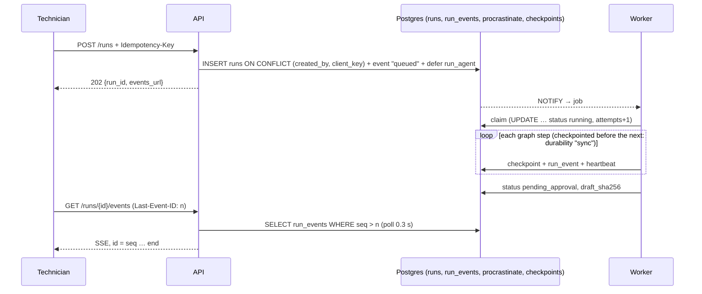

# Agent runs

How a technician's symptom becomes a cited work-order draft waiting for a supervisor, as a durable job that survives disconnects, deploys and dead workers. It covers the design, each decision and the measurement behind it, and what's left. Companion to DESIGN §6.3 and §6.3.1, ADR-0004 and `AGENT.md` (the Phase 0 sketch).

Code: `app/agent/` (`graph.py`, `runner.py`, `tools.py`, `schemas.py`), `app/jobs.py`, `app/api/runs.py`, `app/prompts/agent_*.md`, migration 0008, `app/seed.py`. Tests: `tests/test_agent.py`, `test_agent_kill.py` (two processes, SIGKILL), `test_api_runs.py`. Dates: 2026-11-01.

## 1. A real run

`POST /runs {"registration": "MX-001", "symptom": "After landing, the number 1 engine oil filter bypass indicator popped and the chip detector light came on. Shiny flakes on the chip detector."}`, live model, local corpus, from a laptop:

| seq | Event | Step time | What happened |
| --- | --- | --- | --- |
| 1 | status `queued` | | `POST /runs` inserted the run and deferred the job |
| 2 | status `running` | **0.02 s** | picked up by the worker (LISTEN/NOTIFY) |
| 3 | act | 2.0 s | two tool calls at once: `get_aircraft(MX-001)` and a technical search |
| 4 | tools | 2.1 s | aircraft found; 5 passages |
| 5 | act | 2.3 s | an AD search: "CFM56-7B engine oil filter bypass chip detector bearing spall airworthiness directive" |
| 6 | tools | 1.3 s | 5 passages |
| 7 | act | 4.5 s | no more tools: a one-line summary |
| 8 | diagnosis | 7.3 s | 3 likely causes, confidence medium, 2 checked citations, marked evidence_incomplete (no CFM56-7B AD found) |
| 9 | draft | 10.5 s | **urgent**: "Investigate metal in No. 1 engine oil: inspect chip detector, oil filter, and strain oil sample"; 4 checked citations (Powerplant Handbook p. 8-2, p. 6-28) |
| 10 | status `pending_approval` | | `runs.draft_sha256` set; the stream ends |

**30.2 s** from request to draft (target p95 ≤ 45 s); **$0.0093** (target mean ≤ $0.05). A second run (ATR 72, spongy brake pedal) took 27 s and cost $0.0094, and survived a worker SIGTERM part-way through (§4.4).

## 2. Architecture

The API never executes a run. Every fact about a run is in Postgres, so any API replica can stream any run, a client can re-attach from any point, and a worker can die at any moment.

## 3. The graph

`act ⇄ tools → diagnose → draft → approval (interrupt) → END`. The write node arrives with #12.

### 3.1 No separate `plan` node
AGENT.md sketched a `plan` LLM step before `act`. In practice the first `act` turn plans: the live run's first turn called `get_aircraft` and a search together. A separate plan call would add one LLM round trip (about 2 s) and a cost, without information `act` doesn't already have. Logged as DESIGN P2-28.

### 3.2 State is plain JSON
`AgentState` holds only dicts, lists and strings. Diagnosis and draft are validated with the Pydantic models in `schemas.py` at the node, then stored as dicts. Reasons:
- **Safe checkpoints:** LangGraph's serializer has had deserialization CVEs, and newer versions restrict which types can be loaded. Plain JSON needs neither pickle nor an allow-list (security review S10).
- **Deploys:** dict fields can be added without breaking checkpoints written by an older release (DESIGN §6.3.1). `STATE_SCHEMA_VERSION` changes only on a non-additive change.

### 3.3 Tools (`app/agent/tools.py`)

| Tool | What it does | Notes |
| --- | --- | --- |
| `search_documents(query, top_k ≤ 8)` | The hybrid retriever (`docs/retrieval.md`), public scope | No make/model filter parameters yet: the retriever doesn't support them, and a parameter that does nothing would mislead the model |
| `get_aircraft(registration)` | `tools_fleet` plus the last 5 work orders from the new `tools_work_orders` view (migration 0008) | Unknown registration returns "MX-999 is not in the fleet. Do not use any other aircraft." (the DeepSeek failure, SPIKE §1) |
| `query_sdr` | not yet | arrives with the SDR data (#6) |

- Tool results are capped at about 2k tokens (8,000 characters, at the measured 3.97 characters per token).
- An argument validation error goes back to the model as the tool result. After 2 invalid calls, that tool is withdrawn for the rest of the run (DESIGN §6.3).
- All tools read through `tools_ro`.

### 3.4 Context bound
After each tool round, results older than the last 4 are condensed to one line listing the passage ids they returned (`compact()`). The full passages stay in `evidence` for diagnose and draft. That's the context bound the cost review asked for (DESIGN §7.1, C5).

### 3.5 Checks the code applies after the model
| Check | Rule | Test |
| --- | --- | --- |
| Citations | Each must name a passage this run retrieved, and quote it word for word (normalised). Others are dropped and listed | `test_fabricated_citations_are_dropped_and_flagged` |
| Evidence incomplete | Set if the model says so, the step cap was hit, or no citation survived | same, and `test_step_cap_moves_on_to_diagnosis` |
| Registration | The draft's registration is forced to the run's aircraft, and the correction is recorded in `draft.checks` | `test_a_different_registration_in_the_draft_is_corrected` |
| Priority floor | If a cited AD passage says "before further flight", priority is at least `urgent`, and the raise is recorded | `test_priority_is_raised_when_a_cited_ad_requires_action_before_flight` |
| Draft hash | `sha256` of the canonical JSON draft. The supervisor's decision (#12) must quote it | `test_draft_hash_is_canonical` |

**Registration: corrected, not rejected.** DESIGN §6.3 says the check "rejects" another registration. Since a run *is* about one aircraft, forcing it and recording the correction keeps the draft usable, and the supervisor sees the correction (P2-30).

### 3.6 Model settings
Act turns: `max_tokens` 2,000. Diagnose and draft: 3,000. Reasoning effort `low` for all three, because reasoning tokens count against `max_tokens` (SPIKE §1, and `docs/qa.md` §4.1, where Haiku at `medium` with 900 tokens produced nothing). The step cap is 8 act → tools cycles. Every model call carries the run id, so the gateway's **$0.25 per-run cap** is checked before each call.

## 4. Durability

### 4.1 Checkpoints per step
`graph.astream(..., durability="sync")` writes each completed node's checkpoint before the next node starts. A run interrupted anywhere resumes from its last completed step; only the step that was in progress runs again.

### 4.2 Proven with two processes and SIGKILL (`tests/test_agent_kill.py`)
1. A separate Python process runs the agent with a stub model, and blocks on its third act turn, after two tool rounds are checkpointed.
2. The test sends it **SIGKILL**, so no cleanup runs. The run is left `running`, with 2 tool rounds recorded.
3. A **second process** executes the run. Its model-call log shows `act 2, Diagnosis, WorkOrderDraft`: it resumed at the interrupted turn and didn't redo turns 0 and 1. The run reaches `pending_approval` with `attempts = 2` and an event `{"status": "running", "attempt": 2, "resumed": true}`.

**Checked the other way:** with `durability="exit"`, the second process starts again from act turn 0 and the test fails. SPIKE §3 had marked cross-process resume UNVERIFIED; it's now verified.

### 4.3 The reaper (`reap_runs`, every 5 min)
- Finds runs `queued` or `running` with no heartbeat for `run_stale_after_s` (300 s). That covers a killed worker, and a run whose job was lost (for example, deferring failed after the insert).
- Below `run_max_attempts` (3: one attempt plus two re-queues), it re-defers the job and records `requeued`. That event refreshes the heartbeat, which gives the job a fresh window before the next check.
- At the limit, it fails the run with the reason.
- The job uses `queueing_lock = lock = "run:{id}"`: at most one job per run can be queued, and at most one can execute. This matters when the reaper re-queues while a slow job is still running.

### 4.4 Deploys: SIGTERM drain
On SIGTERM, procrastinate stops taking jobs and waits `worker_shutdown_grace_s` (100 s, below ECS's 120 s `stopTimeout`) for running jobs. **Verified live:** SIGTERM after the second run's first act turn; the worker logged "Stop requested", finished the run 27 s later (one attempt, `pending_approval`), then stopped. A job still running at the end of the grace period is aborted, and the checkpoint plus the reaper cover it.

*Decision:* rely on procrastinate's drain rather than a custom "finish the current step, then stop". With per-step checkpoints, the custom version would only save repeating one step in the rare case where a run outlasts 100 s (P2-29).

### 4.5 Idempotent execution
The claim is `UPDATE runs SET status = 'running', attempts = attempts + 1 … WHERE status IN ('queued', 'running') RETURNING …`. A late or duplicate job on a run that's already paused or finished does nothing (`test_executing_a_paused_run_again_does_nothing`). Known failures (spend cap, no credits, model unavailable, structured-output failure, unsupported model) fail the run immediately with the reason, because a retry can't fix them. Anything else propagates, the heartbeat goes stale, and the reaper takes over.

### 4.6 Versions
Each run records `graph_version`, `prompt_version` (a hash of the three agent prompts), `config_version` and `state_schema_version`. A worker that doesn't serve a run's graph or state version fails it with that reason instead of resuming it into a different graph (DESIGN §6.3.1).

## 5. HTTP

| Route | Behaviour | Tested |
| --- | --- | --- |
| `POST /runs` | Unknown aircraft is a 404 **before anything is spent**; bad format or short symptom is a 422. Dedupe on `(created_by, Idempotency-Key)`: same key and body returns 200 with the same run; same key with a different body is 409. Keys are scoped per user | `test_api_runs.py` |
| `GET /runs/{id}` | status, versions, cost, attempts, and the latest draft. Creator only for now; anyone else gets a 404 | yes |
| `GET /runs/{id}/events` | SSE replay from `?after=` or `Last-Event-ID`, then tail (0.3 s polling) until a state needing no more worker action, then `end`. SSE `id` = event seq | full replay, resume from 7, end |

Bug found by the tests: the ownership check first ran **inside** the SSE generator, where the 200 status is already sent, so a 404 couldn't be delivered. It's now a dependency that runs before streaming starts.

## 6. Measurements

| | Run 1 (737-800 oil metal) | Run 2 (ATR 72 brakes) | Target |
| --- | --- | --- | --- |
| Pickup (queued → running) | 22 ms | 16 ms | p95 ≤ 1 s |
| Symptom → draft | 30.2 s | 27 s | p95 ≤ 45 s |
| Cost | $0.0093 | $0.0094 | mean ≤ $0.05 |

Cost by step (both runs): act $0.0028 (6 calls), tools $0.0100 (8 calls, almost all rerank at $0.0025 per search), diagnose $0.0022, draft $0.0038. Rerank is about half of an agent run's cost. Diagnose (7.3 s) and draft (10.5 s) are the slow steps, and the first place to look in Phase 4.

## 7. Spend
This slice: **$0.0187** (ledger): two live runs. Everything else ran against the scripted model.

## 8. Follow-ups

| Item | Where |
| --- | --- |
| Decision endpoint, approvals row with compare-and-set, write node, `expire_approvals` | #12 |
| `query_sdr` tool | #6 then #11 |
| Safety notes mention ADs for *other* types (correctly flagged as not shown to apply, but noise); safety notes aren't citation-checked | Phase 3 (prompt + eval) |
| Supervisors' access to runs; JWT; per-user concurrent-run limit (2) | #13 |
| Diagnose + draft latency (18 s together) | Phase 4 |
| Run UI | #14 |
