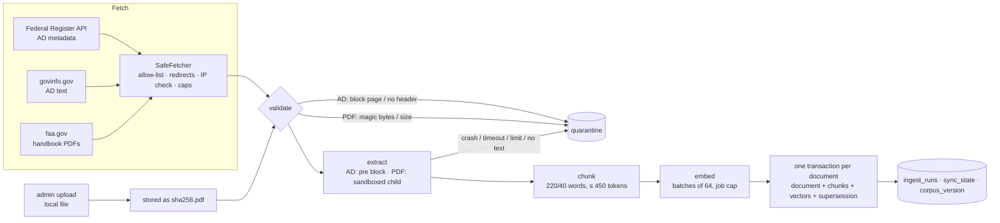

# Ingestion

How documents get from the FAA's public sources into Postgres, why each step works the way it does, and how to run and repair it. It's the detailed companion to DESIGN §6.2 and ADR-0001/0002/0003. Every number below was measured on the full local corpus on 2026-10-29 unless it's marked otherwise.

Code: `app/ingest/`. Tests: `tests/test_fetch.py`, `test_ingest_units.py`, `test_ingest_ads.py`, `test_pdf.py`, `test_ingest_pdfs.py`.

## 1. What's loaded

| Source | Documents | Pages | Chunks | Embed cost | Load time |
| --- | --- | --- | --- | --- | --- |
| Airworthiness Directives 2020-01-06 → 2026-10-27 | 2,545 (11 corrections, 10 revisions; 376 superseded) | — | 44,198 | $0.332 | 33.5 min |
| AMT Handbook – General (FAA-H-8083-30B) | 1 | 677 | 2,310 | | |
| AMT Handbook – Airframe (FAA-H-8083-31B) | 1 | 1,052 | 3,356 | | |
| AMT Handbook – Powerplant (FAA-H-8083-32B) | 1 | 500 | 1,770 | | |
| AC 43.13-1B with Change 1 | 1 | 646 | 1,499 | | |
| **Handbooks + AC** | 4 | 2,875 (9 near-empty, skipped) | 8,935 | $0.045 | 39 s parse + 108 s embed |
| **Total** | 2,549 | | **53,133**, all embedded (voyage-4-lite) | **$0.377** | |

The database is 327 MB. SDR (Service Difficulty Reports) are the next source (#6) and are FTS-only by design (DESIGN §5.1).

## 2. Pipeline

Every stage either produces output or records why it didn't, in `quarantine` or `ingest_runs.error`. Nothing is dropped silently. That was the SPIKE §4 lesson: 235 block pages were once stored as ADs.

## 3. Fetching (`app/ingest/fetch.py`)

| Rule | Why | Test |
| --- | --- | --- |
| https only, host must be on `ingest_allowed_hosts` (federalregister.gov, govinfo.gov, faa.gov, external.apic4e.faa.gov) | Ingestion follows URLs that come from API responses. A changed or spoofed response must not be able to point the worker anywhere (security review S7) | `test_refuses_non_https_and_unlisted_hosts` |
| Every resolved address must be public: no private, loopback, link-local or metadata addresses (169.254.169.254) | SSRF to the ECS task metadata endpoint would leak AWS credentials | `test_refuses_allow_listed_host_resolving_to_private_address` (6 address kinds) |
| Redirects followed by hand, at most 3, each target re-checked | `follow_redirects=True` would skip the check on the second hop | `test_redirect_target_is_rechecked`, `…_loop_is_cut_off` |
| Streamed, abandoned past `max_bytes` (5 MB for AD text, 300 MB for PDFs) | A hostile or broken server can't exhaust memory | `test_oversized_response_is_abandoned` |
| Retries only on 429/5xx and connection errors, exponential backoff, 5 attempts; a 4xx fails at once | Retrying a 404 or a refused URL only adds load and delay | `test_5xx_is_retried…`, `test_4xx_is_not_retried` |
| Honest User-Agent, at least 0.1 s between requests per host, never any bot-check workaround | The data owners' terms; DATA.md "Access notes" | — |

**Known gap:** DNS rebinding between our check and the HTTP client's own lookup isn't closed. The allow-list is a handful of government hosts, which keeps the exposure small. Pinning the resolved IP is a Phase 5 item.

## 4. Airworthiness Directives (`ads.py`, `ad_parse.py`)

### 4.1 Where the data comes from
- **Metadata:** Federal Register API `documents.json`, FAA final rules whose title starts "Airworthiness Directives". One query per calendar year, oldest first, 100 per page.
- **Text:** govinfo.gov's HTML rendition (`…/html/<doc>.htm`, derived from the `pdf_url`). federalregister.gov's own full-text URLs return a bot-check page to scripts, so they aren't used (SPIKE §4).

### 4.2 Parsing, and what real data taught us
Coverage over all 2,545 documents. Re-measure with `uv run python scripts/measure_ad_parse.py`.

| Field | Coverage | How it's read | Quirks found in the data |
| --- | --- | --- | --- |
| AD number | **100 %** | End of the docket header: `…Amendment 39-NNNNN; AD 2020-25-03R1]` | Written as `AD-2025-05-15`, `AD No. 2020-19-12`, bare `2026-08-11`, two-digit years (`AD 92-02-14 R1`), and with typos (`39-21656 AD …` with no semicolon, `39-21749-;`). The first regex found 99.5 % and missed every variant |
| Kind | 2,524 original / 11 correction / 10 revision | FR document prefix `C1-` or a "; Correction" title means correction; an `R<n>` suffix means revision | Corrections and republications are **separate documents sharing an AD number** (45 numbers). The `UNIQUE` constraint had to go (DESIGN P2-9) |
| Supersedes | 23.8 % | "replaces / supersedes / revises AD …" in section (b) Affected ADs | "affects AD …" is *not* supersession and is ignored |
| Applicability | 97.1 % | Section (c), up to the next section header | 2026 text indents headers (`\n\n (d) Subject`); before that fix, applicability was missing for 2 of 8 live ADs |
| Models | 85.2 % (best effort) | Designators after "Model(s)" up to "airplanes / helicopters / engines …" | Ranges like `737-100, - 200, -200C` (a line-wrap space included) are expanded against the base model. Purely numeric designators (`369D`, `500N`) were added. Series fragments such as `117` (from "MBB-BK 117") also get through. That's acceptable for filter metadata, and Phase 3 evals will show if it hurts |
| Make | 100 % | The title after "Airworthiness Directives;", without the trailing kind word | "Engine Alliance Turbofan Engines" → "Engine Alliance"; trailing commas trimmed |
| JASC codes | 42.9 % | "(JASC) Code(s): 3230" in section (d) | Older ADs often have no JASC line |

**Text cleanup:** 276 ADs (11 %) contain NUL and other control characters, GPO formatting artifacts before separator lines. Postgres text can't store NUL, and that crashed the first live run. `app/ingest/text.clean()` strips them for every source.

### 4.3 Supersession
Linked in both directions inside the document's transaction (`store.upsert_document`):
- When AD X replaces AD Y, every document with AD number Y (original and corrections) gets `superseded_by = X`.
- When an older AD arrives after the AD that replaces it (backfills run oldest first per year, but across years and re-runs order isn't guaranteed), it's marked on arrival.

Check on the full corpus: all 376 `superseded_by` links point to a newer AD (`test_supersession_is_linked_in_both_orders` covers both orders).

### 4.4 Incremental sync and the high-water mark
- The scheduled job (`sync_ads`, procrastinate periodic, cron `15 */6 * * *`) reads from `sync_state.high_water_mark` minus 3 days. The overlap catches documents the FR publishes or corrects late.
- Unchanged documents are skipped by content hash, before any embedding spend.
- **Mark rule** (DESIGN P2-11):
  - The scheduled run sets the mark exactly, held at the day before the earliest document that failed, so the next run re-reads it.
  - A one-off backfill (`--since`) only moves the mark forward.
- A failed fetch, or one document's database error, counts as `failed` and doesn't stop the run. Any other crash still closes the `ingest_runs` row as failed, then re-raises so the queue can retry the job.

## 5. Handbooks, AC and uploads (`pdf_docs.py`, `pdf.py`, `pdf_worker.py`)

### 5.1 The sandbox (ADR-0003)
PDFium is native code. Admin uploads make it parse input we don't control, so text extraction runs in a separate, constrained process for every PDF, including the official ones. One code path means the sandbox is exercised on every handbook load, not only on rare uploads.

| Layer | Setting | Enforced by | Verified |
| --- | --- | --- | --- |
| Before parsing | ≤ 300 MB, starts with `%PDF-` | parent | `test_rejects_non_pdf_by_magic_bytes`, `…_oversized_file…` |
| Process | `python -I -m app.ingest.pdf_worker`: isolated mode, no user site-packages, no CWD on the path | parent | every PDF test runs through it |
| CPU | `RLIMIT_CPU` 300 s → SIGXCPU | child, before PDFium is imported | `test_cpu_limit_kills_a_spinning_parser` |
| Memory | `RLIMIT_AS` 2 GB | child. **Linux only**: macOS ignores it, so local runs rely on the wall clock | Linux CI |
| Disk writes | `RLIMIT_FSIZE` 0 | child. CPython ignores SIGXFSZ, so writes fail with EFBIG (errno 27) | `test_worker_limits_block_file_writes` |
| Open files | `RLIMIT_NOFILE` 64 | child | — |
| Wall clock | 600 s, then kill | parent | `test_hung_parser_is_killed…` |
| Pages | ≤ 3,000 | child, before extraction | `test_rejects_too_many_pages` |
| Output | must declare a page count and deliver exactly that many pages | parent | `test_output_must_match…` |

A crash, a signal (`test_crashing_parser…`: SIGSEGV), a limit, a corrupt file, or a PDF with no extractable text all mean **quarantine, never retry**. Retrying a crashing file five times would be the denial-of-service the security review warned about.

### 5.2 Page numbers
A technician cites "Airframe Handbook p. 8-6", but the eval labels and `#page=N` deep links need the PDF page index. Every chunk keeps both (migration 0005):

| Document | PDF page labels embedded? | Printed label found | How |
| --- | --- | --- | --- |
| General | yes | 100 % | PDF page labels |
| Powerplant | yes | 100 % | PDF page labels |
| Airframe | no | 96 % of pages (95 % of chunks) | Last token of the page, e.g. `8-6` |
| AC 43.13-1B | no | 91 % of pages (85 % of chunks) | Footer `Page 8-22 Par 8-37` |

The unlabelled pages are mostly front matter and appendices. Citations fall back to "PDF p. N" there.

### 5.3 Chunking decisions
- **Chunks never span pages,** so each citation is exactly one page (as in the spike).
- **Near-empty pages** (< 50 characters, scanned figures) are skipped: 9 of 2,875, the same 9 the spike found.
- **No prefix on handbook chunks.** ADs get `[AD 2026-21-11: General Electric Company CF34-8C1, …]` because identifiers must survive chunking. Handbook chunks stay unprefixed, because the spike's 0.97 recall@5 was measured that way and #8 has to compare like with like. A "[title, p. 8-6]" prefix is logged as a Phase 3 experiment.
- **Token cap 450**, estimated at 3.9 characters per token. The measured value on this corpus is 3.97: 71.4M characters over 17.98M voyage tokens. This is deliberately not the spend check's pessimistic chars / 3, which would have split most windows in half (DESIGN P2-12). The largest chunk is 1,755 characters, about 450 tokens.
- **Private-use glyphs** (U+E000–U+F8FF, for example `` in the AC's paragraph references) are replaced with spaces. A check on the loaded ADs found 0 affected chunks, so no AD parser-version bump or re-embed was needed.

### 5.4 Uploads
`copilot ingest-pdf FILE --title … [--access public|restricted]`:
- The file is copied to `upload_dir/<sha256>.pdf`. The user's filename never reaches storage or paths.
- The document is `upload:<sha256[:16]>`, `admin_upload`, and **`restricted` by default**.
- `access_level` is exposed in `tools_chunks`. Retrieval (#8) must filter on it inside the SQL, before rerank, so restricted text never reaches Cohere for a user without access (DESIGN §7.2).
- The upload API endpoint and its audit entry come with the admin API (#13). Until then this is an operator command only.

## 6. Storage and change detection
- **One transaction per document:** document row, all its chunks (old ones deleted, embeddings cascade), all vectors, and supersession updates. A document is searchable whole or not at all.
- **Content hash:** `sha256(PARSER_VERSION + text)` for ADs and `sha256(PDF_PARSER_VERSION + bytes)` for PDFs. Bump the constant whenever parsing or chunking output changes, and the next sync re-processes and re-embeds instead of skipping (DESIGN P2-10). This was found when a parser fix didn't reach 8 already-stored ADs.
- `retrieval_config.corpus_version` goes up once per run that changed anything. Cache keys include it (DESIGN §7.2).
- **Embeddings:** `chunk_embeddings(chunk_id, embed_model)`, so a new embedder can be backfilled beside the active one (DESIGN §8.1, P2-1).

## 7. Spend controls
- Every embedding call goes through the gateway: pre-call estimate, run / user / global daily caps, ledger row (`llm_calls.kind = 'embed_corpus'`).
- Per-job cap `ingest_job_cap_usd` (default $1.00), checked before each batch of 64. When it's reached, the run stops with `stopped_early` set and commits nothing for the current document (`test_job_cap_stops_before_spending…`).
- **Text first, vectors later:** `--no-embed` loads text and FTS for free. `copilot embed-missing --cap X` then fills vectors, committing every 64. That makes the cost measurable before it's spent. It's how the handbooks were loaded: estimate $0.052, actual $0.045.

## 8. Operating it

| Task | Command |
| --- | --- |
| Incremental AD sync now | `uv run copilot ingest-ads` |
| AD backfill from a date | `uv run copilot ingest-ads --since 2020-01-01` (add `--no-embed` to defer spend) |
| (Re)load handbooks and AC | `uv run copilot ingest-handbooks [--only faa-ac-43-13-1b] [--no-embed]` |
| Ingest an upload | `uv run copilot ingest-pdf manual.pdf --title "…"` |
| Fill missing vectors | `uv run copilot embed-missing --cap 0.50` |
| Run scheduled jobs | `uv run copilot worker` |
| Re-measure AD parsing | `uv run python scripts/measure_ad_parse.py` |
| Inspect runs | `SELECT * FROM ingest_runs ORDER BY id DESC;` and `SELECT * FROM quarantine WHERE resolved_at IS NULL;` |

**After a parser change:** bump `PARSER_VERSION` (ADs) or `PDF_PARSER_VERSION` (PDFs), re-measure, then run the sync. The documents are re-processed and re-embedded; the full AD set costs about $0.33.

## 9. Known limitations and follow-ups

| Item | Where |
| --- | --- |
| A hard-killed run leaves `ingest_runs.status = 'running'`. Needs the stale-run reaper | #16 |
| Alerts on failed runs, quarantine rate and freshness | #16 |
| Quarantine replay command and upload API (with audit entry) | #13 |
| Unchanged-skip checks the content hash, not missing vectors. Run `embed-missing` after a `--no-embed` load | noted on #5 |
| DNS rebinding window in the fetcher | Phase 5 |
| `RLIMIT_AS` not enforced on macOS | by design: local relies on the wall clock, Linux enforces it |
| Personal names in uploads aren't redacted before embedding (only emails, phones, IDs) | Phase 5 (NER) |
| Model designators include some series fragments | Phase 3 eval decides |
| Handbook chunk prefix | Phase 3 experiment |
