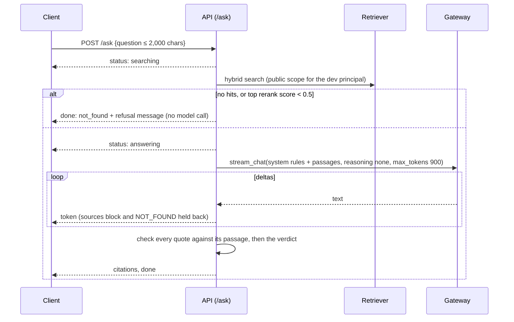

# Cited Q&A

How `POST /ask` turns a question into a streamed answer whose every claim points at a checked quote from an FAA page. It covers the design, each decision and the measurement behind it, and what's left. It's the detailed companion to DESIGN §6.1 and §7.2.

Code: `app/api/main.py`, `app/api/auth.py`, `app/qa/service.py`, `app/qa/answer.py`, `app/prompts/answer.md`, `Gateway.stream_chat` in `app/llm/gateway.py`. Tests: `tests/test_qa_answer.py`, `test_llm_stream.py`, `test_api_ask.py`. Measurements: `scripts/measure_ttft.py` (results in `data/eval/`). Dates: 2026-10-30.

## 1. A real request

`curl -N -X POST localhost:8000/ask -d '{"question":"Drained the oil and the rag is full of shiny bits. Do I pull the engine?"}'`, against the local corpus from a laptop:

| Event | When |
| --- | --- |
| `status {"stage":"searching"}` | **9 ms** (first SSE byte) |
| `status {"stage":"answering","passages":5}` | after retrieval, 1.28 s |
| first `token` | **1.98 s** |
| 49 `token` events, then `citations`, then `done` | 3.55 s total |

The answer says heavy metal particles mean engine removal, and fine filings mean continued inspection, with steps. It cites **Powerplant Handbook p. 8-2** (PDF p. 329, the page the spike's label expects) and **AC 43.13-1B p. 8-4**, each with a checked quote. Verdict `answered`, 1 of 7 sentences uncited. Model cost $0.00049; about **$0.003 per question** including retrieval (target ≤ $0.005).

## 2. Flow

## 3. Events
`status`, `token`, `citations` and `done`, documented in `app/qa/service.py`. The `done.verdict` values:

| Verdict | Meaning | What the UI does |
| --- | --- | --- |
| `answered` | ≥ 70 % of sentences cite a checked quote | show the answer and its citations |
| `not_found` | top rerank score < 0.5 (no model call), or the model replied `NOT_FOUND` | show `message` |
| `refused_unsupported` | too few checked citations (> 30 % of sentences unsupported, or none at all) | **replace** the streamed text with `message`: streamed text can't be unsent, so the verdict decides |
| `generation_unavailable` | model and fallback failed, credits ran out, or a spend cap was hit | show the passages sent as `citations`. Retrieval still worked (DESIGN §6.1 graceful degradation) |

Heartbeats: FastAPI's SSE route sends `: ping` after 15 s of silence, which is DESIGN §7.5's heartbeat, so there's no custom timer.

## 4. Decisions and evidence

### 4.1 Answer model and reasoning: Haiku 5.5, reasoning `none`
Both candidates **reason at `medium` by default** (from OpenRouter's `/models` `reasoning` object), and that delays the first visible token. Measured with the production prompt (~3k tokens) and real retrieval, 5 questions per setting, from a laptop:

| Model, reasoning | First token p50 (max) | Full answer p50 | Notes |
| --- | --- | --- | --- |
| **Haiku 5.5, none (shipped)** | **596 ms** (800) | 2.3 s | 5/5 answered with the final prompt |
| GPT-6 Luna, none | 773 ms (872) | 1.7 s | 4/5 (one uncited opening sentence) |
| GPT-6 Luna, medium | 5,420 ms (8,061) | 5.7 s | over the whole 3 s budget on its own |
| Haiku 5.5, medium | — | — | **no visible text in 5 of 5 runs**: the 900-token budget all went to reasoning |

Haiku at `medium` is exactly the failure OpenRouter's docs warn about: with `max_tokens` too small, the model reasons until the limit and returns `finish_reason: length` with no content, and is still billed. Reasoning is a setting (`answer_reasoning_effort`). Choosing the model for real is Phase 3's job: two earlier runs ranked the models in opposite orders, so n = 5 is noise.

### 4.2 Citations are checked quotes, not just markers
The model ends with `---SOURCES---` and one `[n] "quote"` per citation. The server checks that each quote, after normalising case, whitespace, curly quotes and dashes, appears in passage n. A citation that fails is dropped, with its reason in `citations.dropped`. Sentences count as supported only if they carry a marker for a citation that passed. The tests include fabricated quotes, invented passage numbers and too-short quotes.

**Why quotes and not markers alone:** a marker can point anywhere. A quote has to come from the passage, which turns "the model says passage 2 supports this" into something we can check. Whether the sentence is *entailed* by the quote is the Phase 3 judge's job (groundedness).

### 4.3 Streaming without leaking the machinery
`SourcesSplitter` streams answer text as it arrives, but:
- holds back any tail that could be the start of `---SOURCES---`, since the delimiter arrives split across tokens;
- holds back the opening until it can't be `NOT_FOUND`, so the user never sees the sentinel.

Tested at every chunk size from 1 to 10,000 characters. With the hold-back removed on purpose, 6 tests fail.

### 4.4 Refusal before generation: top rerank score < 0.5
Measured top rerank scores:

| Questions | Top score |
| --- | --- |
| 40 answerable (eval set) | lowest 0.773, median 0.957 |
| Off-domain: sourdough bread, capital of France, Tesla infotainment, Part 117 rest rules | **0.26–0.42** |
| In-domain but unanswerable: wheel-nut torque for a "Boeing 797" (no such aircraft) | **0.765**, overlapping the answerable range |

A threshold of 0.5 refuses off-domain questions without ever refusing a known-answerable one, and saves the model call. **It can't catch in-domain unanswerables.** Those rely on the model's `NOT_FOUND` rule and the citation checks. It's provisional until Phase 3 has a labelled set of unanswerable questions.

### 4.5 Prompt (`app/prompts/answer.md`, `prompt_version` b7a9b2f211eb)
Three changes were made from measurements, each logged:
1. **The AD applicability caveat goes inside the cited sentence.** v1 asked for a separate caveat sentence. It had no marker, counted as unsupported, and tipped otherwise good AD answers into refusal.
2. **"End every sentence with a marker; leave out what you can't cite."** Luna had been writing uncited summary sentences.
3. **"Passages often use different words from the question."** Haiku answered `NOT_FOUND` to the "magnetic plug" question because the passage says "chip detector".

With these, Haiku went from 8/10 answered (2 false `NOT_FOUND`) to **10/10** in the diagnostic runs (`reasoning=none`).

Passages reach the model as escaped `<passage n=… source=… doc=… title=… page=… ad=… superseded_by=…>` blocks, so a passage can't close its own tag (tested with an injection attempt). The system prompt says passage content is data, not instructions.

### 4.6 Disconnects stop spend, and the spend is still recorded
- Both generators (`answer_events`, `stream_chat`) run under `contextlib.aclosing`. Leaving an `async for` because of cancellation does **not** close an async generator, so without it the upstream stream close and the ledger row would wait for garbage collection.
- The cleanup in `stream_chat` runs under `anyio.CancelScope(shield=True)`. Cancellation is level-triggered, so an unshielded `await` in a cancelled task is cancelled again.
- A cut-off stream is still billed, so the ledger gets status `cancelled_estimated` with the prompt estimate plus streamed characters times the completion price.
- The test that proves the shield was **itself wrong at first**: it passed with the shield removed, because its ledger never suspended and anyio only cancels at suspending awaits. It now uses a ledger that suspends, like the Postgres one, and fails without the shield.

### 4.7 Fallback only before the first token
`stream_chat` tries the fallback model only if the primary fails while opening the stream (404, 429, 5xx, timeout). Once text has been shown it can't be swapped, so a failure mid-stream ends as `generation_unavailable`. A 402 never falls back, because the other model shares the account.

### 4.8 Who is asking: a dev principal, local only
JWT auth and the role → access-level mapping are #13. Until then, `X-Dev-User` names the user (for the ledger's salted hash and per-user spend caps), and access is `public` only. `create_app()` refuses to start unless `ENV` is `local` or `test` (tested). A test also checks that restricted chunks never reach the model's prompt or the reranker for this principal. Giving it `restricted` access on purpose makes that test fail.

## 5. Data problems this slice found
1. **PDF hyphenation.** PDFium returns **U+FFFE inside words** where a line breaks them (`ca￾ble`, `re￾gardless`). It was in **76 % of AC 43.13-1B chunks** (6,412 times) and 9 % of handbook chunks. It broke keyword search (`ca` + `ble`), embeddings and quote checks. The cleaner now removes it (and U+00AD), and `PDF_PARSER_VERSION` 2 re-processed and re-embedded the four PDFs ($0.045). Full-text recall@5 went 0.70 → **0.72**, scenario questions 0.59 → **0.68**.
2. **HNSW after a bulk replace.** The re-ingest left 8,935 dead rows in `chunk_embeddings`. HNSW recall fell from 0.996 to 0.988, and vector recall@5 from 0.80 to 0.75. Autovacuum hadn't run, because the default 20 % threshold is about 10.6k rows on this table. A manual `VACUUM` restored it (0.991, 0.80). Migration 0007 lowers the threshold to about 2 % for this table.

## 6. Tests
- 26 answer and splitter tests;
- 6 stream tests (tokens and cost, 402, fallback, both models down, early stop, cancellation with a suspending ledger);
- 11 API tests (full event sequence, restricted scope, low relevance, NOT_FOUND, fabricated quotes, model down, input validation, per-user ledger, dev auth refused outside local).

Mutation checks were run on the splitter hold-back, the cancellation shield and the access scope. Each of those tests fails without the code it protects.

## 7. Spend
This slice: **$0.2031** (ledger, by kind):
- retrieval eval re-run after the text fix: $0.0875
- re-embedding the four PDFs: $0.0449
- time-to-first-token measurements: $0.0348
- refusal diagnostics: $0.0178
- relevance-threshold probes: $0.0150
- one live end-to-end request: $0.0030

## 8. Follow-ups

| Item | Where |
| --- | --- |
| Choose the answer model (Haiku vs Luna) on the golden set; Luna's ~20 % refusals on short answers | Phase 3 |
| Calibrate the 0.5 relevance threshold with labelled unanswerable questions | Phase 3 |
| Groundedness judge: is each sentence entailed by its quote? | Phase 3 |
| JWT, roles → access levels, rate limit of 60 Q&A per hour | #13 |
| Exact-match and semantic answer caches, query-embedding cache | Phase 4 |
| React client: render tokens, replace on refusal, footnoted citations | #14 |
| In-region time to first token | Phase 8 |
