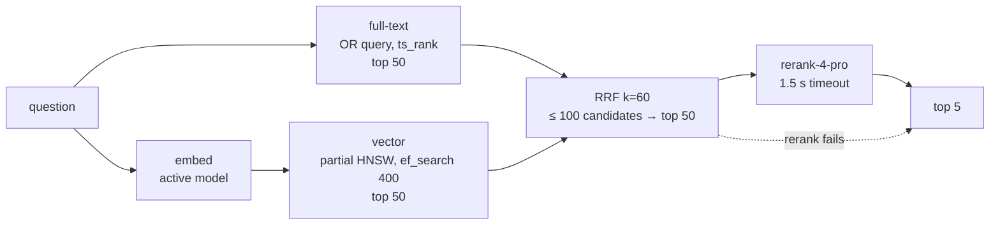

# Retrieval

How a question becomes the five passages an answer is built from: the design, every setting and why it has its value, and the measurements behind each decision. It's the detailed companion to DESIGN §6.1 and §8 and to ADR-0002.

Code: `app/retrieval/search.py`, `vector_index.py`; migration 0006. Tests: `tests/test_retrieval.py`. Evaluation: `scripts/eval_retrieval.py` (results in `data/eval/`, git-ignored). All numbers are from 2026-10-30 on the full local corpus: 2,549 documents, 53,133 chunks, voyage-4-lite vectors.

## 1. Pipeline

- Access control is applied **inside both SQL queries** (`access_level = ANY(...)`). Restricted text is never fetched for a user without access, so it can't reach the reranker either (`test_restricted_chunks_never_returned_or_sent_to_the_reranker`).
- The embedding call and the full-text query run **concurrently**.
- Every query runs as `tools_ro`: read-only, 5 s statement timeout, allow-listed views only.

## 2. Results on the spike's 40 questions

recall@5 / MRR@5, page-level match (same questions and scoring as SPIKE §2b). "Page" = 18 keyword-style questions, "scenario" = 22 technician-style questions.

| Variant | page | scenario | all | Spike equivalent (all) |
| --- | --- | --- | --- | --- |
| Full-text, OR + `ts_rank` | 0.83 / 0.65 | 0.59 / 0.41 | **0.70 / 0.52** | BM25 0.68 / 0.54 |
| Full-text, OR + `ts_rank_cd` | 0.50 / 0.38 | 0.27 / 0.12 | 0.38 / 0.24 | — |
| Full-text, AND then OR | 0.83 / 0.68 | 0.59 / 0.41 | 0.70 / 0.53 | — |
| Vector (HNSW, ef_search 100) | 0.67 / 0.64 | 0.82 / 0.63 | 0.75 / 0.64 | exact search 0.78 / 0.57 |
| **Vector (HNSW, ef_search 400)** | 0.72 / 0.69 | 0.86 / 0.68 | **0.80 / 0.69** | exact search 0.78 / 0.57 |
| Hybrid RRF (ef 400, demotion 0.5) | 0.89 / 0.77 | 0.73 / 0.53 | 0.80 / 0.64 | 0.85 / 0.64 |
| **Hybrid RRF (ef 400, no demotion): the fallback** | 0.83 / 0.74 | 0.77 / 0.62 | **0.80 / 0.67** | 0.85 / 0.64 |
| **Hybrid + rerank: shipped** | **0.94 / 0.92** | **1.00 / 0.82** | **0.97 / 0.86** | 0.97 / 0.87 |

**The Postgres implementation reproduces the spike** where it matters: hybrid + rerank 0.97 / 0.86 against 0.97 / 0.87, and 1.00 on the scenario set. The one question that misses ("glowing dye under black light", fluorescent penetrant) missed in every spike configuration too. Phase 3 checks its label.

At n = 40, one question is 0.025. Read differences of one or two questions as noise.

## 3. Decisions, with the evidence for each

### 3.1 Full-text ranking: OR query ranked by `ts_rank` (not `ts_rank_cd`, not AND-first)
- The open risk in DESIGN §9 was "Postgres FTS isn't BM25". Answered: OR + `ts_rank` scores **0.70** against BM25's **0.68** overall. It's better on scenario questions (0.59 vs 0.50) and worse on keyword ones (0.83 vs 0.89).
- `ts_rank_cd` (cover density) suits AND-style phrase matching. For OR queries it's **badly worse (0.38)** and 3x slower (293 ms vs 90 ms on an 8-term question).
- AND-then-OR gave the same quality (0.70 / 0.53 alone, 0.80 hybrid) and runs two queries whenever AND finds fewer than 50 hits, which is the usual case for full-sentence questions. Not worth it.
- The OR form comes from `plainto_tsquery` with `&` swapped for `|`, so user input is never parsed into tsquery syntax by our code.

### 3.2 HNSW `ef_search` = 400, set per query
The spike computed **exact** cosine similarity. Postgres uses **approximate** HNSW. Measured against an exact scan on the 40 eval queries (top 50):

| `ef_search` | recall@50 vs exact: mean | worst query | p50 | p95 |
| --- | --- | --- | --- | --- |
| 40 (pgvector default) | 0.931 | 0.56 | 2.7 ms | 4.9 ms |
| 100 (the design's value) | 0.951 | 0.60 | 2.8 ms | 3.7 ms |
| 200 | 0.982 | 0.68 | 3.9 ms | 5.4 ms |
| **400** | **0.996** | **0.92** | 4.1 ms | 5.6 ms |
| 1000 | 1.000 | 0.98 | 5.6 ms | 7.5 ms |
| exact scan | 1.000 | 1.00 | 66.6 ms | 67.9 ms |

The design chose 100 so a top 50 wouldn't be cut down to 40 rows, but never checked recall. At 100, one query lost 40 % of its true neighbours. **400 costs about 2 ms and lifted vector-only recall@5 from 0.75 to 0.80 and hybrid from 0.75 to 0.80.** It's set with `SET LOCAL` in the vector query's transaction, from `RetrievalConfig.ef_search`. A test proves the setting applies and doesn't leak back to the pool. The role default stays 100 for any other query.

*How this was found:* the hybrid fallback scored 0.75 against the spike's 0.85. The per-question diff showed the vector side missing AD chunks that exact search found. A first measurement wrongly reported 1.000 recall at every setting: psycopg had auto-prepared the statement under `enable_indexscan = off`, and the cached exact-scan plan survived the `RESET`, so exact was compared with exact. The flat 67 ms timings exposed it. The re-run used separate connections and `prepare_threshold=None`, with an `EXPLAIN` assertion that HNSW is in the plan.

### 3.3 One partial HNSW index per model, named as a literal
- `CREATE INDEX CONCURRENTLY … USING hnsw (embedding halfvec_cosine_ops) WHERE embed_model = '<model>'` (migration 0006 for voyage-4-lite). Partial, so a second model's vectors can be backfilled beside the active one without mixing graphs (DESIGN §8.1).
- **Build:** about 12 s for 53,133 vectors, **138 MB** (about 2.6 KB per vector), with `maintenance_work_mem` raised for the build. Projected about 0.5 GB at the full-history size of 200k chunks, in line with the cost review's halfvec estimate.
- **The model name is inlined as a SQL literal**, validated against a strict pattern. Postgres only uses a partial index if it can prove the query's `WHERE` implies the predicate. A bind parameter can't be proven under a generic plan. `test_partial_index_is_usable_with_a_literal_model_name` shows the index used with the literal and not used with a generic-plan parameter.
- The planner then does: HNSW index scan → nested loop to `chunks` and `documents` → access filter, with iterative scan continuing if filtered rows leave fewer than 50. 15 ms in `EXPLAIN ANALYZE`.

### 3.4 Rerank stays, as the ADR decided
Rerank lifts recall@5 from 0.80 to 0.97 and MRR from 0.67 to 0.86, the same jump the spike measured. It costs **$0.0025 per question** (83 % of the estimated $0.003 per Q&A) and **p50 ~720 ms, p95 0.94–1.22 s** (n = 80 live calls from the laptop).

### 3.5 Supersession demotion: off by default
Multiplying the RRF score of superseded-AD chunks by 0.5 **never changed recall** and **lowered MRR** (0.64 vs 0.67). With rerank on it has **no effect at all**, because the reranker re-scores the whole candidate set. So it's off (`superseded_factor = 1.0`), with the mechanism kept. Superseded ADs are still returned, deliberately (someone may ask about an old AD by number), with `superseded_by` on every hit. The answer step (#9) must say "superseded by …". Phase 3 adds supersession-specific questions to test any ranking change.

### 3.6 Why the fallback (RRF order) is 0.80, not 0.85
For the 5 questions the spike's hybrid found and ours misses, the target **is** a candidate, at fused rank 6–10:

| Question (shortened) | Full-text rank | Vector rank (ef 100) | Fused rank |
| --- | --- | --- | --- |
| PC-24 windshield heat relay | **1** | absent | 7 |
| AW119 starter-generator shaft | 3 | absent | 10 |
| New airworthiness limitation | 6 | 15 | 7 |
| Nylon-insert nut | 37 | **1** | 10 |
| Turbine exhaust temperature | 6 | 12 | 6 |

RRF with k = 60 rewards appearing in **both** lists over ranking first in **one**. A rank-1 hit in a single list (1/61) loses to chunks mid-rank in both. `ef_search` 400 recovered some of this. The rest is RRF's nature plus the changed AD chunking (prefix with models, the 450-token cap). The reranker recovers all of them. DESIGN §6.1 now states 0.80 for the fallback. Weighted RRF or a larger k are Phase 3 experiments, not something to tune on 40 questions.

## 4. Latency

Per stage, warm, local Docker on a laptop, 53k chunks (80 searches):

| Stage | p50 | p95 | Notes |
| --- | --- | --- | --- |
| Full-text | 51.5 ms | 112.2 ms | runs **concurrently** with the embedding call |
| Query embedding (live) | 353 ms | 656 ms | n = 40, from the laptop |
| Vector | 5.7 ms | 8.3 ms | ef_search 400 |
| Fetch rows | 1.5 ms | 1.7 ms | |
| Rerank (live) | ~720 ms | 0.94–1.22 s | n = 80 |
| **Retrieval critical path** | | **≈ 1.8 s** | max(full-text, embed) + vector + fetch + rerank |

Against the 3.0 s time-to-first-token target, that leaves about **1.2 s** for the answer model's first token. The design had estimated 2.4 s for retrieval, from slower embedding p95s. In-region numbers come in Phase 8.

**Scale risk (UNVERIFIED at 200k):** broad OR queries match up to 31 % of chunks (16,235 rows for the 8-term "shiny bits in oil" question), and ranking is linear in matches. That could be about 0.4 s p95 at 200k chunks. That's still hidden behind the embedding call as long as it stays below the embedding latency, and that's what to watch in the Phase 8 load test.

## 5. Degraded modes

| Failure | Behaviour | `degraded` flag | Quality |
| --- | --- | --- | --- |
| Reranker error, timeout (1.5 s) or spend cap | RRF order | `rerank_unavailable` | 0.80 recall@5 |
| Embedding API down | full-text only | `embedding_unavailable` | 0.70 |
| No index for the active model | full-text only, logged as an error | `vector_index_missing` | 0.70 |

Each mode has a test. None fails the request.

## 5b. After the PDF text fix (#9)
The answer step found U+FFFE hyphenation marks inside words in 76 % of AC chunks (`docs/qa.md` §5). After removing them, re-embedding the PDFs and vacuuming:

| Variant | Before | After |
| --- | --- | --- |
| Full-text (OR + `ts_rank`) | 0.70 / 0.52 | **0.72 / 0.55** (scenario 0.59 → 0.68) |
| Vector (ef 400) | 0.80 / 0.69 | 0.80 / 0.69 |
| Hybrid RRF (the fallback) | 0.80 / 0.67 | 0.80 / 0.67 |
| **Hybrid + rerank** | 0.97 / 0.86 | **0.97 / 0.87** |

Before the vacuum, vector-only had dropped to 0.75: the re-ingest left 8,935 dead HNSW entries and autovacuum hadn't run. Migration 0007 fixes that (DESIGN P2-25).

## 6. Spend

Evaluation: **$0.20** uncached (40 query embeddings, 80 rerank calls across variants). Cached in `data/eval/cache.json`, so re-runs are free unless the candidate sets change.

## 7. Follow-ups

| Item | Where |
| --- | --- |
| Larger, harder golden set (≥ 150 questions, including supersession) to confirm these choices | Phase 3 (#17) |
| Weighted RRF / larger k; handbook chunk prefix | Phase 3 experiments (#20) |
| Answer step must state `superseded_by` | #9 |
| Full-text p95 at 200k chunks; in-region embed and rerank latency | Phase 8 (#27) |
| Query-embedding cache on the normalised question (DESIGN §8 lever 1) | #9 or Phase 4 |
